# PARADOX (PRDX)

> 🌐 **[Русская версия](../ru/docs.md)**

This document describes the contract rules of the PARADOX protocol on TON and Solana, their mathematics and the simulation results.

     

| Network | Reserve | Address |
|---|---|---|
| [TON testnet](https://testnet.tonviewer.com/kQDTGn-ZvqG33QAKWXSA5uVKHVgZ9xljk0fZAcIDPIbX9q1q) | Gram | `kQDTGn-ZvqG33QAKWXSA5uVKHVgZ9xljk0fZAcIDPIbX9q1q` |
| [TON testnet](https://testnet.tonviewer.com/kQCnJJvRzo20tFM2xlADW8g62yo0Q4ZFxqmo1TaTHDrVq7kH) | test USDT | `kQCnJJvRzo20tFM2xlADW8g62yo0Q4ZFxqmo1TaTHDrVq7kH` |
| [Solana devnet](https://explorer.solana.com/address/GEnxVEpR9ALBhqhQPgPqeb59VAZS2JxTFt4hUArRD2yJ?cluster=devnet) | SOL | program `GEnxVEpR9ALBhqhQPgPqeb59VAZS2JxTFt4hUArRD2yJ` |
| Solana devnet | USDT | the same program, not launched yet |

> ⚠️ The protocol runs on test networks with tokens of no real value. Do not send mainnet funds to it.

---

## In one minute

PARADOX is a protocol on the TON and Solana blockchains. Its PRDX token can be held or spent on tickets to mine new tokens (mining). The payout is random: it can be many times the ticket price, but on average it is smaller.

Here is the paradox: the more PRDX is spent on tickets, the faster every PRDX gains in price on average. Why buy tickets, then, instead of simply holding PRDX? The answer is in item 6 and section 7. Why the price grows is described in items 1 and 4.

1. **Backing.** PRDX is fully backed by the reserve: the PRDX price equals the reserve divided by the number of PRDX issued. Minting for coins (Mint) and exchanging back for coins (Burn) go at this price and do not change it, and Burn cannot be paused. Each pair of network and reserve currency (TON: Gram, USDT; Solana: SOL, USDT) has its own PRDX.
2. **Ticket.** A ticket is bought for PRDX: the right to mine new PRDX. The payout follows the rules of the St. Petersburg game, an 18th-century problem whose paradox gave the protocol its name (§3.1). All possible payouts with their chances are known before the purchase. A payout can be many times the ticket price.
3. **Average payout.** The ticket price is calculated so that the average payout equals exactly 87.5% of the price for any level and any number of attempts (§3.3).
4. **Deflation.** On average the other 12.5% burns while the reserve does not change, so mining shrinks the PRDX supply and raises its price. Everyone who has PRDX gets what burned through the price growth, in proportion to their PRDX. The protocol withholds only the Mint and Burn fees of 1.5625% (figure 5).
5. **Statistics.** By the law of large numbers, the more tickets, the closer the burned share of PRDX comes to 12.5%, and by the central limit theorem the deviation shrinks in proportion to $1/\sqrt{N}$, where $N$ is the number of tickets (section 6). So the price growth rests on the statistics of all tickets, not on the luck of a single one. A price fall after a large payout is bounded by the limit (section 5). Simulations in [prdx-sim](https://github.com/prdx-admin/prdx-sim) that follow the contract rules agree with this calculation (figure 3). In simulation, for 100 to 100,000 participants the price fell in 1–4% of years.
6. **Two strategies.** Alice keeps PRDX and gains from the price growth. Bob spends PRDX on tickets: on average he gives up 12.5% of each ticket's price, and in return gets a chance of a payout many times the ticket price. The strategies can be combined (section 7).
7. **A fair outcome.** The outcome is computed from the miner's secret and a random number. On TON the number is sent by an oracle, on Solana it is published by the drand network. The miner commits the secret before the number exists, and the source of the number sees only the hash of the secret, so neither the miner nor the source of the number chooses the outcome. The secret and the number are recorded on the blockchain, and anyone can recompute the outcome (section 9).
8. **Conditions.** The price grows only while mining goes on, and it is expressed in the reserve coin. The protocol runs on test networks with tokens of no real value; the risks are collected in section 12.

---

## Contents

1. [How the protocol works](#1-how-the-protocol-works)
2. [PRDX price, Mint and Burn](#2-prdx-price-mint-and-burn)
3. [The mining ticket](#3-the-mining-ticket)
4. [Actions with a ticket](#4-actions-with-a-ticket)
5. [Payout limit](#5-payout-limit)
6. [PRDX price growth](#6-prdx-price-growth)
7. [Alice's and Bob's strategies](#7-alices-and-bobs-strategies)
8. [Participation model](#8-participation-model)
9. [Mining randomness](#9-mining-randomness)
10. [Contracts and parameters](#10-contracts-and-parameters)
11. [How to try the protocol](#11-how-to-try-the-protocol)
12. [Risks](#12-risks)
13. [Frequently asked questions](#13-frequently-asked-questions)
14. [Glossary](#14-glossary)

The charts come from the [prdx-sim](https://github.com/prdx-admin/prdx-sim) simulator, which follows the contract rules.

---

## 1. How the protocol works

The protocol works on two networks: TON and Solana. The networks are not linked. On each network PRDX is issued for two currencies:

| Network | Currencies |
|---|---|
| TON | Gram, USDT |
| Solana | SOL, USDT |

Each pair of network and currency works on its own: it has its own PRDX token, its own reserve, its own price and its own tickets. For example, PRDX issued on TON for Gram cannot be exchanged for PRDX issued on TON for USDT, nor for PRDX on Solana.

The main contract stores two numbers:

| Symbol | What it is |
|---|---|
| **G** | coins in the reserve |
| **P** | PRDX issued |

The price of one PRDX is **G/P**.

Holders and miners work with the protocol. In this document the holder is called Alice and the miner is called Bob.

**Alice** gets PRDX for coins and keeps them. **Bob** gets PRDX for coins and buys tickets with them to mine PRDX.

Only the main contract can issue PRDX. It does so in two cases: on Mint and on mining with a ticket. On **Mint** a participant puts coins into the reserve, and the contract issues PRDX to them at the current price G/P minus the fee. On **Burn** a participant sends PRDX to the contract, the contract burns them and pays out coins from the reserve at the current price G/P minus the fee. Mint and Burn change G and P in the same proportion, so they do not change the price. The two fees of 1.5625% take about 3.1% of the amount together. So a participant gets more coins on Burn than they put in on Mint only if the price growth in between covers both fees. The fees protect against arbitrage around someone else's mining (§2.5).

Bob buys a ticket for PRDX. The ticket gives the right to mine PRDX. When Bob starts mining, the contract burns the PRDX paid, and at the end issues the payout as new PRDX. The reserve does not change. The payout on average equals 87.5% of the ticket price. So on average there are fewer PRDX after mining at the same reserve, and the price G/P grows.

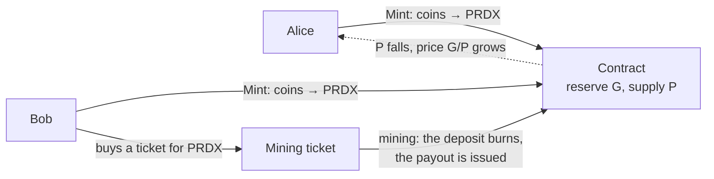

Of the participants' funds the protocol withholds only the Mint and Burn fees. Everything miners lose on tickets on average goes, through the price growth, to everyone who has PRDX, Alice included, in proportion to their PRDX (figure 5). These properties follow from the ticket price formula (§3.3) and the law of large numbers (section 6).

---

## 2. PRDX price, Mint and Burn

All examples in this document are for the TON network and the Gram currency.

### 2.1. Price

The PRDX price equals the reserve divided by the supply:

$$
\text{PRDX price} = \frac{G}{P}
$$

> **Example.** The reserve holds 100 Gram, and 10,000 PRDX are issued. One PRDX costs 0.01 Gram, that is, 1 Gram = 100 PRDX. The TON contracts started on the testnet at this price.

### 2.2. Mint

Alice puts in 10 Gram. The reserve holds 100 Gram, and 10,000 PRDX are issued.

1. The contract sets aside the 1.5625% fee, that is, 0.15625 Gram. The fee does not enter the reserve: fees accumulate in the main contract separately, and governance withdraws them (§10.1).
2. The remaining 9.84375 Gram go into the reserve.
3. The contract issues 984.375 PRDX to Alice at a price of 0.01 Gram.

| | Before | After |
|---|---|---|
| Supply **P** | 10,000 PRDX | 10,984.375 PRDX |
| Reserve **G** | 100 Gram | 109.84375 Gram |
| Price **G/P** | 0.01 Gram | 0.01 Gram |

### 2.3. Burn

Burn turns PRDX back into reserve coins: this is how a holder takes the price growth. A holder sends 1,000 PRDX to Burn.

1. The contract withholds the 1.5625% fee, that is, 15.625 PRDX. These PRDX do not burn and stay in the supply.
2. The remaining 984.375 PRDX burn.
3. The holder receives 9.84375 Gram from the reserve.

| | Before | After |
|---|---|---|
| Supply **P** | 10,000 PRDX | 9,015.625 PRDX |
| Reserve **G** | 100 Gram | 90.15625 Gram |
| Price **G/P** | 0.01 Gram | 0.01 Gram |

While an operation is processed, the price may change because of someone else's mining. So Mint and Burn carry an allowed slippage from 0.1% to 100%. If the price changes by more than the allowed slippage, the contract cancels the operation and returns the funds.

### 2.4. Exchanging PRDX for the reserve

PRDX works like money under the gold standard: it is fully backed by the reserve and exchanged for it on demand. The difference is the exchange rate: it is not fixed, it equals G/P and grows on average. The price is in the reserve coin, so against other currencies PRDX rises and falls together with that coin.

PRDX needs no exchange: a participant issues it, and Burn is available at any moment. Mint is available while governance has not paused it. Both operations go at the price G/P. PRDX is still a standard token: ordinary wallets and block explorers show its balance, and PRDX can be transferred like any token of the network.

### 2.5. The role of the fees

A ticket's deposit burns when mining starts, and the payout is issued after the secret is revealed (§4.3). Between these moments the PRDX price is higher than it will be after the payout is issued. Without fees, a participant could Mint before someone else's ticket starts mining and Burn before the payout is issued, taking part of the price growth without risk. Issuing the payout would then lower the price for those who hold PRDX. With the fees such a round trip pays off only if the burned deposit raises the price by more than the two fees. With a large supply, an ordinary ticket's deposit raises the price far less.

---

## 3. The mining ticket

### 3.1. The St. Petersburg game

In 1713 Nicolaus Bernoulli, in a letter to Pierre Rémond de Montmort, proposed a problem: a die is thrown until a six comes up, and the payment grows as 1, 2, 4, 8, 16. In 1728 Gabriel Cramer, in a letter to Nicolaus Bernoulli, wrote down the same problem with a coin. The problem appeared in the second edition of Montmort's book on games of chance (1713). In the same year Nicolaus Bernoulli published his uncle Jacob Bernoulli's "Ars Conjectandi", which proves the law of large numbers: the more trials, the closer the frequency of an event comes to its probability. The steadiness of the PRDX price growth rests on this law (section 6).

A coin is tossed until heads comes up. If heads comes up on the first toss, the player gets 1 coin, on the second toss 2 coins, on the third 4 coins. With every further toss the payment doubles.

The expected value of this game is infinite:

$$
\mathbb{E} = \tfrac{1}{2}\cdot 1 + \tfrac{1}{4}\cdot 2 + \tfrac{1}{8}\cdot 4 + \ldots = \tfrac{1}{2} + \tfrac{1}{2} + \tfrac{1}{2} + \ldots = \infty
$$

Yet people are willing to pay only a few coins to play. Cramer in 1728 and Daniel Bernoulli, Nicolaus's cousin, in 1738 explained this gap by the diminishing utility of money. Daniel Bernoulli's paper "Specimen theoriae novae de mensura sortis" ("Exposition of a New Theory on the Measurement of Risk") appeared in the journal of the St. Petersburg Academy of Sciences, "Commentarii Academiae Scientiarum Imperialis Petropolitanae". The paper states the problem with a coin, and by the same argument Bernoulli works out when a Petersburg merchant should insure goods shipped by sea from Amsterdam. After the journal the game is called the St. Petersburg game, and the gap between the expectation and the price of playing is called the St. Petersburg paradox. The PARADOX protocol is named after it.

The original game cannot be run in practice: its prize is unbounded, and there is nothing to pay it with. A PARADOX ticket's payout follows the same rules, but the number of tosses is limited by the ticket's level, and mining starts only if the largest payout is within the limit (section 5). The payout does not come out of the reserve: the contract issues it as new PRDX, which lowers the price of each PRDX.

### 3.2. Mining rules

The mining rules are open. The size and the probability of every outcome are written in the contract and known before a ticket is bought.

The word "mining" is borrowed from Bitcoin by similarity: mining costs money, and the payout is random. Otherwise mining works differently. In Bitcoin a miner's chance depends on their share of the network's computing power, miners compete for every block, and mining confirms transactions. In PARADOX the chance is set by the ticket's level, one ticket's payout does not depend on other tickets, and mining confirms no transactions.

A ticket has three parameters:

| In the app | In formulas | What it sets | Allowed values | Why change it |
|---|---|---|---|---|
| **LVL** | $n$ | number of possible outcomes of an attempt | 2 to 32 | a high LVL gives a rare large payout, a low one a payout closer to the average |
| **MIN** | $E$ | smallest payout of an attempt | from 1 PRDX | the ticket's scale: at the same LVL the ticket price is proportional to MIN |
| **DRAWS** | $a$ | number of attempts | 1 to 8 | more attempts bring the payout closer to the average at the same deposit |

Mining a ticket consists of attempts. An attempt goes like this. A coin is tossed until heads comes up, but no more than $n-1$ times. If heads came up on the first toss, the payout equals MIN. With every further toss the payout doubles. If heads did not come up in $n-1$ tosses, the payout is the largest:

$$
\text{MAX} = E \cdot 2^{\,n-1}
$$

The payout of outcome number $k$ equals $E \cdot 2^{\,k-1}$, and its probability is:

$$
p_k = \begin{cases}
\dfrac{1}{2^{\,k}}, & k = 1, \ldots, n-1 \\[6pt]
\dfrac{1}{2^{\,n-1}}, & k = n
\end{cases}
$$

> **Example.** A ticket with LVL 6, MIN 4 PRDX and one attempt. The ticket costs 16 PRDX.
>
> | Heads came up | Payout | Probability |
> |---|---|---|
> | on toss 1 | 4 | 50% |
> | on toss 2 | 8 | 25% |
> | on toss 3 | 16 | 12.5% |
> | on toss 4 | 32 | 6.25% |
> | on toss 5 | 64 | 3.125% |
> | not in 5 tosses | 128 | 3.125% |

### 3.3. Ticket price

The ticket price is called the **deposit** $D$. The deposit is calculated by a formula under which the average payout equals 87.5% of the deposit. In the contracts this share is the **RTP** parameter:

$$
D = \frac{a \cdot E \cdot (n + 1)}{2 \cdot \text{RTP}},
\qquad
\mathbb{E}[\text{payout}] = 0.875 \cdot D
$$

The formula holds for any LVL and any number of attempts: the 87.5% average payout is an exact equality, not an estimate. The ticket in the example above pays out $4 \cdot 7 / 2 = 14$ PRDX on average for a 16 PRDX deposit. The other 12.5% of the deposit burns on average and raises the PRDX price for everyone who has PRDX. For Bob it is the average loss on each ticket.

### 3.4. Average payout and spread

A ticket has two measures, and both are known before the purchase.

The **average payout** is 87.5% of the deposit for any settings (§3.3).

The **spread** shows how far a single ticket's payout lies from the average. The spread is set by the level and the number of attempts (§3.5). As the level grows, a payout above the deposit comes as often or more rarely, and the rare large payout becomes larger. In the table the spread is measured by the standard deviation of the payout of a ticket with one attempt:

| LVL | MIN | MAX | Chance of mining more than the deposit | Chance of MAX | Standard deviation |
|---|---|---|---|---|---|
| 2 | 0.58·D | 1.17·D | 50% | 1 in 2 | 0.29·D |
| 4 | 0.35·D | 2.8·D | 25% | 1 in 8 | 0.80·D |
| 8 | 0.19·D | 25·D | 12.5% | 1 in 128 | 2.5·D |
| 12 | 0.13·D | 276·D | 12.5% | 1 in 2,048 | 7.4·D |
| 16 | 0.10·D | 3,373·D | 6.25% | 1 in 32,768 | 23·D |
| 24 | 0.07·D | 587,203·D | 6.25% | 1 in 8,388,608 | 248·D |

At LVL 2 the payout is 0.58 or 1.17 of the deposit. At LVL 24 the payout is below the deposit in 15 cases out of 16, and the largest payout exceeds the deposit 587 thousand times.

Figure 1 shows the payouts of 10,000 miners with identical tickets. At LVL 2 every second miner mines more than the deposit, at LVL 24 every sixteenth.

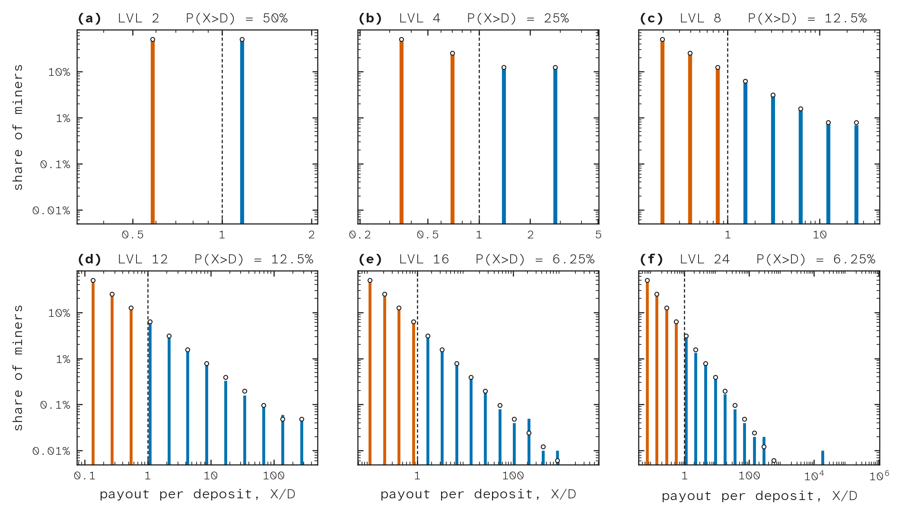

*Figure 1. 10,000 miners buy an identical ticket with one attempt. A bar shows the share of miners with that payout, a circle the exact probability $2^{-k}$. Blue marks a payout above the deposit, orange below it. The panel title gives the exact share of tickets that mine more than the deposit.*

### 3.5. Several attempts on one ticket

Several attempts are chosen to bring the ticket's payout closer to the average. If DRAWS is greater than one, the contract runs several attempts and adds up their payouts. The average payout stays at 87.5% of the deposit, and at the same level and deposit the spread shrinks: with eight attempts it is almost three times smaller than with one. The ticket's smallest payout equals $E \cdot a$. The ticket's largest payout at the same level and deposit does not change, but it comes much more rarely: it needs MAX in every attempt.

---

## 4. Actions with a ticket

### 4.1. Buying a ticket

Bob buys a ticket: deposit 32 PRDX, LVL 3, one attempt. The contract debits 32 PRDX from Bob's wallet but does not burn them. Until mining these PRDX stay in the supply $P$. The RTP and the grace period at the moment of purchase are written into the ticket: if governance changes them later, Bob's ticket keeps the old values. At purchase the contract checks that the ticket's MIN is not below the smallest MIN and its LVL not above the largest LVL. Governance sets both values. The contract checks them only at purchase, so changing them does not affect a bought ticket.

A ticket can be bought without starting mining: for example, to give it away or to start mining later.

On TON a ticket is an NFT. On Solana a ticket is stored in a separate program account.

### 4.2. Actions before mining

| Action | Result | Why |
|---|---|---|
| **Keep** | nothing changes, the ticket has no expiry | start mining later, for example when the limit grows |
| **Transfer** | the ticket passes to another owner | give or sell the ticket |
| **Lower the level** (RESHAPE) | LVL decreases, MIN grows or stays the same; the deposit, DRAWS and the average payout stay the same | start mining a ticket over the limit |
| **Cancel** | Bob gets exactly 87.5% of the deposit, the other 12.5% burns | get PRDX back if Bob changes his mind about mining |
| **Start mining** | the deposit burns, mining starts (§4.3) | get the payout |

RESHAPE is the standard way to start mining a ticket over the payout limit (section 5). Bob lowers the level: at the same deposit MIN grows and MAX shrinks, and the ticket passes the limit. The average payout stays at 87.5% of the deposit. The contract refuses a RESHAPE that raises LVL or lowers MIN: this keeps the ticket within the terms checked at purchase. RESHAPE is available almost always: at LVL 2 the largest payout equals 1.17 of the deposit, so any ticket with a deposit of no more than about 10.7% of the supply passes the limit.

Canceling is equivalent to mining a ticket with a single outcome. At $n = 1$ the deposit formula gives a single payout $\text{RTP} \cdot D$, that is, the same 87.5%.

> **Example.** Bob cancels a ticket with a 32 PRDX deposit. Bob gets 28 PRDX, and 4 PRDX burn.

### 4.3. Mining procedure

1. Bob sends the hash of the secret. The contract checks the payout limit and burns the deposit.
2. A random number appears: on TON an oracle sends it, on Solana a drand round comes out (§9.1). From this moment the **grace period** runs: the time to reveal the secret. By default it lasts 24 hours, on the testnet 5 minutes.
3. Bob reveals the secret. The contract computes the payout and issues it in full.

If the secret is not revealed by the end of the grace period, Bob can close the ticket with the smallest payout $E \cdot a$: this way the ticket closes even if the secret is lost.

However a ticket ends, the result for the supply is the same: the deposit is burned, and PRDX are issued to Bob. In mining the deposit burns at the start (step 1), on canceling at the moment of canceling.

| The ticket ended | Bob gets |
|---|---|
| Bob revealed the secret | the payout from the attempts' outcomes |
| the grace period expired | $E \cdot a$ |
| Bob canceled the ticket | 87.5% of the deposit |

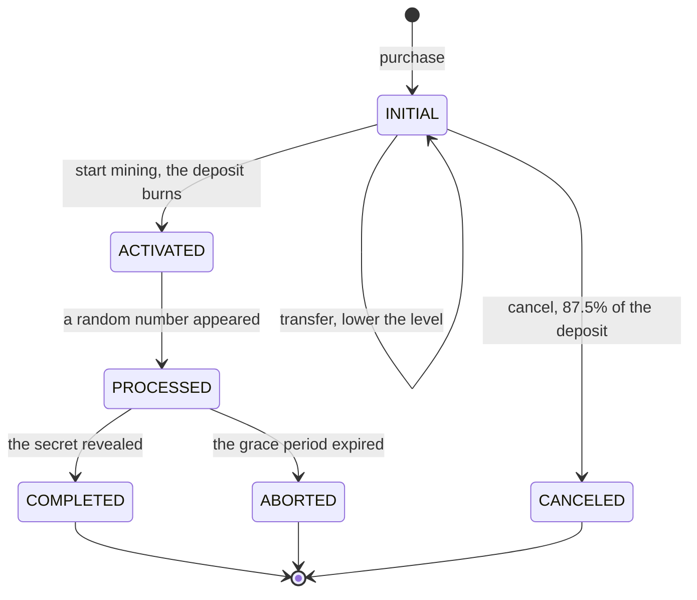

---

## 5. Payout limit

Mining a ticket starts only if the ticket's largest payout is no more than 12.5% of the supply. A ticket over the limit can be bought, but mining it cannot start. The contract checks the limit when Bob starts mining:

$$
E \cdot 2^{\,n-1} \cdot a \;\le\; 0.125 \cdot P
$$

If the ticket passed the check, the contract issues the payout in full, even if the supply changed by the end of mining.

> **Example.** 100,000 PRDX are issued, so a ticket's largest payout is no more than 12,500 PRDX. Bob wants to start mining a ticket with a 1,000 PRDX deposit at LVL 20. The largest payout of such a ticket is 43.7 million PRDX, and the contract rejects the operation. The deposit does not burn. Bob lowers the level:
>
> | LVL | MIN | MAX | Passes the limit |
> |---|---|---|---|
> | 20 | 83 | 43,690,000 | no |
> | 9 | 175 | 44,800 | no |
> | 7 | 219 | 14,000 | no |
> | **6** | **250** | **8,000** | **yes** |
>
> At LVL 6 the ticket passes the limit, and the average payout stays at 87.5% of the deposit.

As the supply grows, the limit grows, and high levels become available again. A ticket over the limit can be kept until then or moved to an allowed level right away (RESHAPE, §4.2).

The limit bounds the fall of the price after a large payout. The contract issues a payout of 12.5% of the supply as new PRDX, and the PRDX price falls by about 11%: $1 - 1/1.125 \approx 0.11$. If large payouts come on several tickets at once, the price falls more.

If mining goes on, such a fall is temporary: mining of the other tickets again shrinks the supply on average, and the price grows. In simulation, two years after a payout of 12.5% of the supply the price lags the run without it by 6% (figure 8a).

Figure 8d shows how the limit affects the growth of the reserve and the price falls.

---

## 6. PRDX price growth

Only mining and canceling a ticket change the supply without changing the reserve. On canceling exactly 12.5% of the deposit burns, in mining 12.5% burns on average. For a single ticket the supply can also grow: this happens when the payout is larger than the deposit.

> **Example.** The reserve holds 1,000 Gram, and 100,000 PRDX are issued. In one round miners burn 1,000 PRDX on average.
>
> | Round | Burned | Supply P | Reserve G | Price of 1,000 PRDX |
> |---|---|---|---|---|
> | 0 | — | 100,000 | 1,000 | 10.000 Gram |
> | 1 | 1,000 | 99,000 | 1,000 | 10.101 Gram |
> | 2 | 1,000 | 98,000 | 1,000 | 10.204 Gram |
> | 3 | 1,000 | 97,000 | 1,000 | 10.309 Gram |
>
> Over three rounds Alice's 1,000 PRDX gained 3.1% in price on average.

Let mining run on tickets with a sum of deposits $V$, and let $P_0$ PRDX be issued at the start. If exactly the average share burned on the tickets, then

$$
\frac{\text{price}}{\text{starting price}} = \frac{1}{1 - 0.125 \cdot V/P_0}
$$

If the sum of deposits equals the starting supply, the price grows 1.14 times. If it is twice as large, 1.33 times.

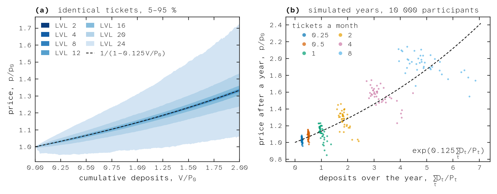

*Figure 2. (a) The PRDX price as mining proceeds on identical tickets, 2,000 runs. Each level's band covers 5–95% of the runs, the dashed line shows the growth formula. The spread grows with the level: the bands of LVL 2–12 are narrower than the dashed line, the band of LVL 24 widens to 0.95–1.7 by the end. (b) Each point is one year of the protocol with 10,000 participants. Miners buy 0.25 to 8 tickets a month. The dashed line shows the same formula for deposits that grow with the supply: $\exp(0.125 \cdot \sum D/P)$. Most years lie above the dashed line. The points to the right of and below the cloud are years with a large payout: the miner spends a share of the grown capital on tickets again, so the sum of deposits grows, while the price after a large payout is lower.*

The formula describes the average result. The actual result depends on each ticket's payout, and by the law of large numbers the more tickets, the closer the result to the formula. By the central limit theorem the share of deposits burned in a round of $N$ identical tickets stays within $\pm 2\sigma/\sqrt{N}$ of 12.5% in about 95% of cases, where $\sigma$ is the standard deviation of one ticket's payout as a share of the deposit (§3.4). At LVL 4 already 1,000 tickets burn a share of deposits close to 12.5% (figure 3). In simulation with 100 to 100,000 participants the PRDX price fell in 1–4% of years.

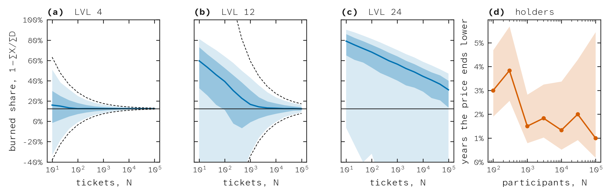

*Figure 3. (a–c) The panels show the share of deposits burned in a round of $N$ identical tickets. At LVL 4, 1,000 tickets are enough for the share to approach 12.5%. At LVL 24 even a hundred thousand tickets are not enough: a rare large payout shifts the result strongly. The dashed line shows 12.5% ± 2σ/√N. (d) The panel shows the share of years in which the PRDX price fell.*

---

## 7. Alice's and Bob's strategies

### 7.1. Two extreme strategies

Alice and Bob follow two extreme strategies. A participant can choose any strategy between them: for example, keep most PRDX and buy tickets with the rest.

| | Alice | Bob |
|---|---|---|
| Actions | gets PRDX for coins and keeps them | gets PRDX for coins and buys tickets with them |
| Income | PRDX price growth | payouts on tickets |
| Costs | Mint and Burn fees; the price fall after someone else's large payout | Mint and Burn fees; 12.5% of each deposit on average |
| Result | price growth while other participants mine | a chance to mine a sum that is a multiple of the deposit |

The economists Milton Friedman and Leonard Savage explained in 1948 why the same person can both insure against losses and buy lottery tickets. A participant of the protocol can likewise combine both strategies.

### 7.2. How a participant's result is calculated

A participant's result in reserve coins, not counting the Mint and Burn fees, equals the product of two factors:

$$
\text{result} = \underbrace{\frac{\text{price at the end}}{\text{price at the start}}}_{\text{the same for everyone}} \times \underbrace{\frac{\text{PRDX at the end}}{\text{PRDX at the start}}}_{\text{each participant's own}}
$$

The second factor depends on two of the participant's decisions.

**How much PRDX to spend on tickets.** On each ticket a participant loses 12.5% of the deposit on average. Let a participant buy 24 tickets a year and spend on each ticket the same share of the PRDX they have at that moment. The sum of these shares over a year is called the turnover $T$.

| Share of PRDX per ticket | Turnover $T$ | PRDX after a year, on average |
|---|---|---|
| 1/24 | 1 | 88% of the starting amount |
| 1/6 | 4 | 60% of the starting amount |

For any number of tickets the amount of PRDX over a year is multiplied on average by about $e^{-0.125\,T}$.

**Which level to choose.** The level does not change the average result, but it changes the typical one. At a low level most participants' results are close to the average. At a high level most participants end the year below the average, and a few mine many times more (figure 4a).

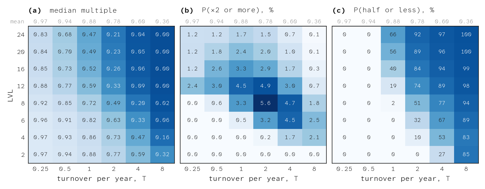

*Figure 4. A participant buys 24 tickets with one attempt over a year. The horizontal axis shows the turnover $T$, the exact average factor is given above the bars. The panels show: (a) the median PRDX factor, (b) the chance to double PRDX over a year, %, (c) the chance to lose half of PRDX over a year, %. The chance to double PRDX is highest at LVL 8–12 with turnover 2. Low-level tickets almost never double, and on high-level tickets the large payout comes too rarely.*

### 7.3. Risk profile

In the simulation each participant has a risk profile ρ from 0 to 1. A participant with ρ = 0 acts like Alice, a participant with ρ = 1 like Bob. As ρ grows, a participant spends a larger share of PRDX on tickets, picks a higher level and fewer attempts per ticket. The participants are split into five classes: Alice (ρ = 0), three intermediate classes and Bob (ρ from 0.75 to 1).

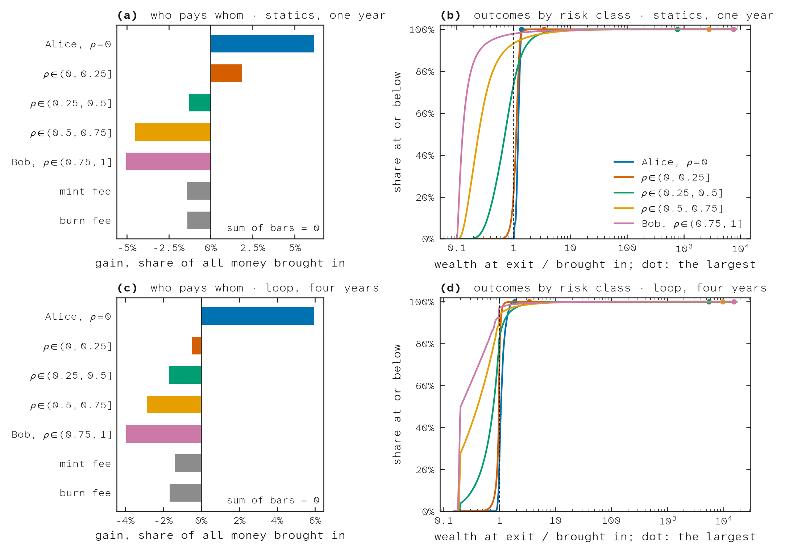

*Figure 5. Two participation models. The top row is the closed population: 20,000 participants, one year, 100 runs. The bottom row is the inflow model (section 8): participants arrive and leave, four years, 20 runs, ε = 0.8. (a, c) The panels show the outcome of each class of participants and the Mint and Burn fees as shares of all coins put in. The bars sum to zero: holders receive what miners lose on average, minus the fees. (b, d) The panels show the distribution of outcomes within each class. The axis runs to the largest outcome, and a dot marks the largest outcome of each class.*

In the simulation holders and participants with a low ρ end most years with a profit. Participants with a high ρ lose part of their PRDX more often, but only among them are those who multiplied their capital tenfold or more in a year. In the inflow model holders also gain, and all classes of miners lose on average, including the class with ρ up to 0.25. A miner in this model leaves when less than 20% of what they brought remains, so on panel (d) the miners' outcomes start at about ×0.2. In both models the largest outcomes of single miners exceed ×1000.

---

## 8. Participation model

This section describes a model of participants' behavior. The model is not part of the contract rules. Its results show a possible dynamics of the protocol.

### 8.1. How holders and miners affect each other

The largest allowed payout of a ticket equals 12.5% of the supply. In reserve coins this is 12.5% of the reserve. New holders increase the reserve, and the largest payout grows with it. Cook and Clotfelter (1993) showed on US state lotteries that the larger the top prize, the more tickets are sold. In the model miners behave the same way: they come the more often, the larger the largest payout. New miners burn more PRDX, and the price grows faster. In the model, when the price grows fast, new holders come more often.

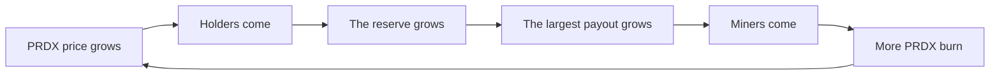

The holder's annual price growth is approximately

$$
y \approx 0.125 \cdot \frac{V}{G}
$$

where $V$ is the sum of deposits over a year in reserve coins at the price at the time the tickets are bought, and $G$ is the reserve. If holders leave and miners stay, the same 12.5% is shared by a smaller reserve, and the price grows faster. Then holders come back more often. If there are too many holders, the price growth per holder slows down, and some holders leave.

### 8.2. Model assumptions

| Parameter | Assumption |
|---|---|
| holders | come the more often, the more $y$ exceeds the alternative yield $r^*$ (5% a year in the base case) |
| miners | come the more often, the larger the largest payout; the sensitivity ε shows by how many percent more miners come when the largest payout grows by 1% |
| miner's strategy | every miner has their own risk profile ρ (§7.3): it sets the share of PRDX spent on tickets, the level and the number of attempts |
| exit | holders leave the less often, the more $y$ exceeds $r^*$; a miner leaves when less than 20% of what they brought remains |
| start | 10,000 participants |

If ε is below 1, the reserve grows to a stable size. If ε is above 1, the reserve grows while there are new participants in the market.

### 8.3. Participation simulation results

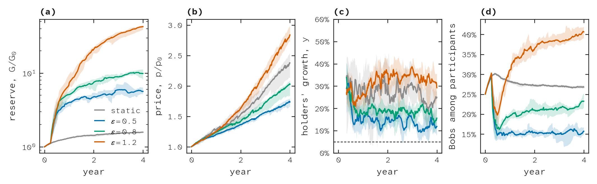

*Figure 6. The simulation covers four years of the protocol, 20 runs. The panels show: (a) the reserve, (b) the PRDX price, (c) the holder's annual price growth $y$, (d) the share of miners. The grey line shows a model without feedback: participants come at a constant rate. In that model the reserve grows 1.5 times and the price 2 times, because 12.5% of deposits is shared by a small reserve. With feedback at ε = 0.5 and ε = 0.8 the reserve grows 5–9 times and the price 1.6–1.8 times. At ε = 1.2 the reserve grows 37 times and the price 2.5 times.*

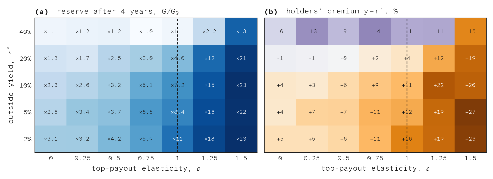

*Figure 7. Each cell is built from eight runs. (a) The panel shows how many times the reserve grew over four years: from ×1.0 to ×23. The reserve grows faster at a larger ε and a smaller alternative yield $r^*$. (b) The panel shows how much the price growth exceeds the alternative yield in the last year, in percentage points. At ε = 1.5 the price growth exceeds the alternative yield for any $r^*$ in the range, at ε = 1.25 for $r^*$ up to 20%. The dashed line marks ε = 1.*

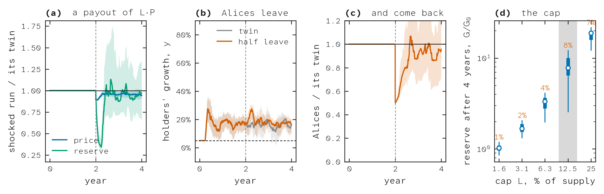

*Figure 8. Each run with an event is compared with the same run without it, ε = 0.8. (a) On day 730 one miner mines 12.5% of the supply. The price falls by about 11% and by the end of the fourth year lags the run without the event by 6%. (b, c) On day 730 half of the holders leave. The price growth for the remaining holders speeds up; within half a year the number of holders returns to 81% of the run without the event (median), and by the end of the fourth year to 96%. (d) The panel shows the reserve after four years at different payout limits. The typical largest one-day price fall is given above the bars. At a 12.5% limit the reserve grows 7.8 times, and the largest one-day fall is 8%.*

In figure 8d a 1.6% limit gives a one-day fall of 1%, but the reserve barely grows. A 25% limit gives 19 times reserve growth and a 7% fall.

---

## 9. Mining randomness

The mining result depends on two numbers: the miner's secret and a random number. On TON the random number is sent by an oracle, on Solana it is published by the drand network.

$$
\text{result} = \text{miner's secret} \oplus \text{random number}
$$

Mining follows a commit-reveal scheme:

1. **The miner commits the secret.** When starting mining, the miner sends the SHA-256 hash of the secret. After that the miner cannot replace the secret: finding another secret with the same hash is infeasible in practice.
2. **A random number appears.** On TON the oracle's key is written into the ticket at the start of mining, and the contract accepts only a number signed with this key. On Solana the number of a drand round and the key of the drand network are written into the ticket at the start of mining (§9.1).
3. **The miner reveals the secret.** The contract checks the secret against the hash and computes the result. For each attempt the contract takes 32 bits of the result. The number of consecutive ones starting from the lowest bit, taken up to $n-1$, equals the number of tosses before the first heads.

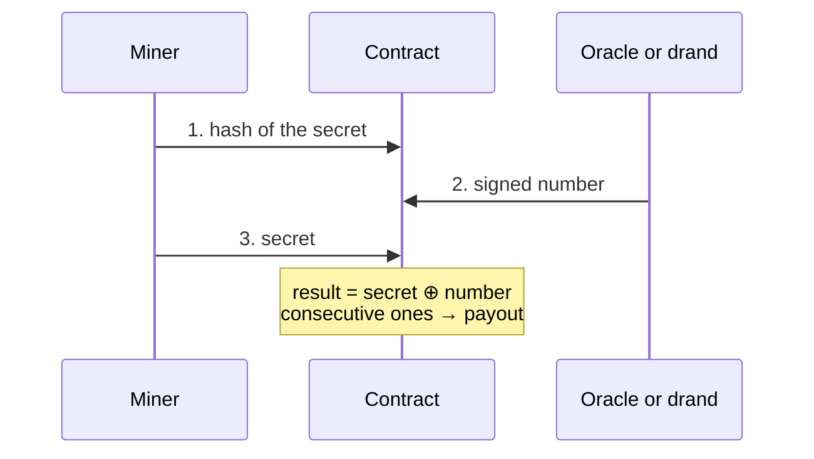

Neither the miner nor the source of the number can choose the result: the secret is committed before the number appears, and the source of the number sees only the hash of the secret. Not revealing the secret does not help the miner either: the ticket then closes with the smallest payout, which is no larger than any outcome.

After the reveal the secret and the random number are recorded on the blockchain, and anyone can recompute the result.

### 9.1. drand rounds on Solana

drand is a network of independent members that publishes the random number of a new round every 3 seconds. The number of a round is a BLS signature over the round's number, assembled by a threshold of the network's members. A round number has exactly one valid signature, so the network does not choose the number, it only publishes it.

1. **Start of mining.** The program writes into the ticket the round that comes out no earlier than the deployment's delay from now (60 seconds on the testnet), and the key of the drand network. The miner's secret is already committed, and the signature of that round does not exist yet.
2. **Reveal.** The miner sends the secret together with the round's signature. The program checks the signature with the key written into the ticket and derives from it the ticket's random number, bound to the ticket's number. The program rejects the signature of another round or one under another key.
3. **The grace period** runs from the time the round comes out. After it the ticket closes with the smallest payout $E \cdot a$.

Nobody delivers the number: the drand network publishes the round's signature, and the miner attaches it to the reveal, so there is no delivery fee.

---

## 10. Contracts and parameters

### 10.1. Protocol parameters

The values are read from the TON main contracts on the testnet.

| Parameter | Value | Where it applies |
|---|---|---|
| Mint and Burn fee | 1.5625% | not part of the reserve |
| RTP | 87.5% | written into the ticket at purchase |
| Payout limit | 12.5% of the supply | checked at the start of mining |
| Smallest MIN | 1 PRDX | checked at purchase |
| Largest LVL | 24 (32 by default) | checked at purchase |
| DRAWS | 1 to 8 | |
| Grace period | 5 minutes (24 hours by default) | written into the ticket at purchase |

Governance is the address of the main contract's administrator. Governance can change the fees, the limit and the source of the random number (the oracle key on TON, the drand network on Solana), and for new tickets the RTP, the grace period, the smallest MIN and the largest LVL. Fees accumulate in the main contract separately from the reserve, and governance withdraws them. Governance can pause Mint, ticket purchases and the start of mining. Burn, revealing the secret, canceling, transferring a ticket and lowering its level cannot be paused. Governance commands do not change PRDX balances. The limit is checked at the start of mining, so after it changes a bought ticket may need a lower level (RESHAPE, §4.2).

### 10.2. TON contracts

| Standard | Use |
|---|---|
| **TEP-74** | PRDX and holders' wallets |
| **TEP-89** | finding a PRDX wallet address |
| **TEP-62** | tickets as NFTs of the protocol's collection |

The main contract issues PRDX, holds the reserve, keeps the ticket collection and accepts governance commands. Two main contracts run on TON: with a reserve in Gram and with a reserve in USDT (jetton). Each holder has their own PRDX wallet, each ticket its own contract.

### 10.3. Solana program

The Solana program works by the same rules. On Solana a ticket is transferred with a program command, also only before mining. The random number on Solana comes from a drand round, not from an oracle (§9.1).

---

## 11. How to try the protocol

1. Open the app in a browser, [app.prdxcoin.com](https://app.prdxcoin.com), or in Telegram, [@prdxcoinbot](https://t.me/prdxcoinbot). Telegram offers the TON deployments; the browser offers the TON and Solana deployments.
2. Turn on **TRIAL** mode. In this mode the app works with a test balance without a wallet: you can Mint, buy a ticket and mine PRDX with it, and view the history of operations. The grace period in TRIAL lasts 1 minute; the other parameters match the testnet.
3. To work with the testnet, open the **CONNECT** section, choose the network and the reserve currency (on TON: Gram or USDT, on Solana: SOL) and connect a wallet. Test coins come from the faucet of the network.
4. The **HOW IT WORKS** plate on the main screen opens the introductory tutorial: the protocol's paradox and Alice's and Bob's strategies. The **?** button in the app's header opens a detailed tutorial on the current section.

Website: [prdxcoin.com](https://prdxcoin.com) · app: [app.prdxcoin.com](https://app.prdxcoin.com), [@prdxcoinbot](https://t.me/prdxcoinbot) · channel: [t.me/prdxcoinproject](https://t.me/prdxcoinproject) · simulator: [prdx-sim](https://github.com/prdx-admin/prdx-sim) · documentation source: [prdx-docs](https://github.com/prdx-admin/prdx-docs)

---

## 12. Risks

- **Test network.** The protocol is experimental and runs on test networks.
- **Average ticket result.** The average payout equals 87.5% of the deposit. On each ticket a participant loses 12.5% of the deposit on average. The larger the share of PRDX a participant spends on tickets, the lower their average result (§7.2).
- **Price fall after a large payout.** The contract issues the payout as new PRDX, and the price falls. A payout at the limit lowers the price by about 11%. In simulation such a fall is temporary: in the closed population the price fell in 1–4% of years, in the inflow model in 3 years out of 120 (sections 5, 6 and 8). If large payouts come on several tickets at once, the price falls more.
- **Dependence on miners.** The price grows with the sum of deposits (section 6). If there are no miners, the price does not grow.
- **Price in the reserve coin.** The PRDX price is in the reserve coin. Against other currencies PRDX rises and falls together with that coin.
- **USDT freeze.** USDT is issued by Tether, which can freeze USDT on any address, including the reserve's, for example at a regulator's request. Gram and SOL are the networks' own coins and cannot be frozen this way.
- **Contract bugs.** As with any blockchain protocol, the contracts may contain bugs.
- **Governance.** Governance changes the protocol's parameters and can pause Mint, ticket purchases and the start of mining. Burn cannot be paused. A bought ticket keeps its RTP and grace period.

---

## 13. Frequently asked questions

### 13.1. What are the fees on issuing (Mint) and exchanging (Burn), and what are they for?

**1.5625%** on each operation. The protocol takes the Mint fee in coins and does not add it to the reserve, and takes the Burn fee in PRDX and does not burn it. Neither operation changes the PRDX price. The fees protect against arbitrage. The PRDX paid for a ticket burn when mining starts, and the payout is issued later, so between these moments the PRDX price is higher. Without fees, a participant could buy PRDX before someone else's ticket starts mining and sell before the payout is issued, and the price fall from the payout would land on those who hold PRDX. With the fees, a sale returns more coins than were put in on purchase only if the PRDX price growth between the purchase and the sale covers both fees.

### 13.2. How does PRDX differ from stablecoins?

A stablecoin's rate is pegged to the dollar or another currency. PRDX is backed by the reserve and can be exchanged for reserve coins at any time, but its price equals the reserve divided by the number of PRDX issued and grows on average while mining goes on. The PRDX price is expressed in the reserve coin, so against other currencies it moves together with that coin.

### 13.3. How is PRDX different from a pyramid scheme?

In a pyramid scheme old participants are paid with the money of new ones, and the payments stop when new ones stop coming. In PARADOX issuing PRDX for coins does not change the price, so new participants joining pays nobody by itself. Only the average shortfall on tickets raises the PRDX price, and miners give it up for a chance to mine many times more. If mining stops, the PRDX price stops growing but does not fall. All PRDX together are backed by the reserve and can be exchanged for reserve coins at any time at the same price.

### 13.4. Does PRDX need an exchange?

No: a participant issues PRDX by putting coins into the reserve and can exchange it back for reserve coins at any time. Both operations go at a price equal to the reserve divided by the number of PRDX issued. PRDX is still an ordinary token of its network: wallets show it, and it can be transferred.

### 13.5. Are TON, Solana and the reserve currencies connected?

No. On TON PRDX is issued for Gram or USDT, on Solana for SOL or USDT, and each of the four pairs works separately: it has its own PRDX, its own reserve, its own price and its own tickets. PRDX of one pair cannot be exchanged for PRDX of another.

### 13.6. Which standards are PRDX and tickets issued under?

On TON PRDX is issued under the Jetton standard (TEP-74), and a ticket as an NFT (TEP-62). The NFT's description records the ticket's level and state, and TON wallets show the ticket among other NFTs.

On Solana PRDX is issued under the SPL Token standard. A ticket there is not an NFT: it is kept in a separate account of the protocol's program and can be transferred with a command of that program.

On both chains a ticket can be transferred to another owner only before mining starts.

### 13.7. What is PRDX mining?

A ticket gives the right to mine PRDX. When mining starts, the PRDX paid for the ticket burn, and the protocol issues the payout as new PRDX. A ticket has three parameters:

- **LVL** from 2 to 32: the number of possible payouts.
- **MIN** from 1 PRDX: the smallest payout of one attempt.
- **DRAWS** from 1 to 8: the number of attempts.

In each attempt a coin is tossed until heads, but no more than LVL − 1 times, and with each toss without heads the payout doubles. The average payout equals **87.5%** of the ticket price for any parameters.

### 13.8. Who decides the payout, and where does the word “mining” come from?

No one chooses the payout: it is computed from the miner's random number (the secret) and a random number from outside. On TON this number is sent by an independent service (the oracle), on Solana it is published by the drand network. The protocol records the secret in hidden form before this number appears. The miner can no longer change the secret, and the source of the number sees only its hash. Both numbers are kept on the blockchain, and anyone can recompute the payout.

The word “mining” comes from the similarity with Bitcoin: mining costs money, and the payout is random. Otherwise mining works differently: the chances are set by the ticket level, one ticket's payout does not depend on other tickets, and mining confirms no transactions.

### 13.9. Can you lose PRDX on mining?

Yes. On average a ticket returns 87.5% of its price, so the miner loses 12.5%. With one attempt on a high LVL the payout is most often below the ticket price and rarely many times above it: on LVL 24 the payout is below the ticket price in 15 cases out of 16, and the largest payout exceeds the price 587 thousand times.

### 13.10. How large can one ticket's payout be?

Up to 12.5% of all PRDX issued, that is, up to a ninth of the reserve in coins at the price after issuing. This limit grows with the number of PRDX issued: **the more PRDX are issued, the larger the payout one ticket can bring**.

The limit protects those who hold PRDX: the protocol issues the payout as new PRDX, and a payout at the limit lowers their price by about 11%, not more. A ticket over the limit can be bought now and mined when there are more PRDX, or its level can be lowered (RESHAPE).

### 13.11. Can I change my mind after buying a ticket?

Yes, while mining has not started. A ticket can be canceled for exactly 87.5% of its price, and the other 12.5% burns. A ticket can also be given away or transferred to another address, and a ticket over the limit can be moved to a lower level (RESHAPE).

### 13.12. Can the PRDX price fall?

Yes. The protocol issues mined PRDX, so a large payout increases the number of PRDX at the same reserve, and the PRDX price falls; large payouts on several tickets at once lower it more. The fall from one payout is limited: about 11% at most.

If mining goes on, such a fall is temporary: the number of PRDX shrinks again on average, and the PRDX price grows. In prdx-sim simulations the PRDX price fell in 1–4% of years with 100 to 100,000 participants, and in 3 years out of 120 in the model where participants arrive and leave.

### 13.13. Can anyone freeze or take my PRDX?

Not on the protocol's side. Governance cannot change PRDX balances and cannot pause Burn, so PRDX can always be exchanged for reserve coins. Governance can pause Mint, ticket purchases and the start of mining and change parameters for new tickets, while a ticket already bought keeps its share of the average payout.

A USDT reserve carries an outside risk: USDT is issued by Tether, which can freeze USDT on any address, including the reserve's, for example at a regulator's request. Gram and SOL are the networks' own coins and cannot be frozen this way.

### 13.14. What are the protocol's risks?

- The protocol is experimental and runs on test networks.
- On average a miner loses 12.5% of a ticket's price.
- After a large payout the PRDX price falls.
- The PRDX price grows only while mining goes on.
- The PRDX price is expressed in the reserve coin and moves against other currencies together with it.
- The issuer of USDT, Tether, can freeze a USDT reserve; a reserve in Gram or SOL has no such risk.

---

## 14. Glossary

| Term | Meaning |
|---|---|
| **PRDX** | the protocol's token, backed by the reserve; on each network a separate PRDX is issued for each currency |
| **Reserve, G** | coins on the main contract's account: Gram or USDT on TON, SOL or USDT on Solana |
| **Supply, P** | the amount of PRDX in circulation |
| **PRDX price** | G/P, the price of one PRDX in the reserve coin |
| **Mint** | issuing PRDX for coins put into the reserve, at the current price G/P |
| **Burn** | burning PRDX and paying out coins from the reserve at the current price G/P |
| **Ticket** | the right to mine PRDX, bought for PRDX; an NFT on TON |
| **Mining** | issuing PRDX on a ticket: the contract burns the deposit and issues the payout |
| **Attempt** | a series of coin tosses until the first heads, no more than $n-1$ tosses; a ticket has 1 to 8 attempts |
| **Payout** | the PRDX the contract issues on a ticket |
| **Deposit, D** | the ticket price in PRDX |
| **LVL, n** | the number of possible outcomes of an attempt |
| **MIN, E** | the smallest payout of one attempt |
| **MAX** | the largest payout of one attempt, $E \cdot 2^{n-1}$ |
| **DRAWS, a** | the number of attempts on a ticket |
| **RTP** | the average payout as a share of the deposit, 87.5% |
| **Spread** | how far a single ticket's payout lies from the average; set by the level and the number of attempts |
| **RESHAPE** | lowering a ticket's level before mining with the same deposit; the standard way to start mining a ticket over the limit |
| **Payout limit** | the condition to start mining: the ticket's largest payout is no more than 12.5% of the supply |
| **Grace period** | the time to reveal the secret after the random number appears |
| **Oracle** | a service that sends signed random numbers to tickets on TON |
| **drand** | a network that publishes signed random numbers in rounds; the source of the random number on Solana |
| **Governance** | the address of the main contract's administrator: changes parameters, withdraws fees, can pause Mint, ticket purchases and the start of mining |
| **Turnover, T** | the sum of the shares of a participant's PRDX spent on tickets over a year |

---

## Disclaimer

This document describes the current state of the PARADOX protocol. The current parameter values are stored in the contracts.

This document is not financial advice. PARADOX is an experimental protocol on test networks. A participant can lose part or all of the funds put in. By interacting with the protocol you confirm that you:

- understand the protocol's mathematical model and its risks;
- use test tokens of no real value;
- are responsible for your own decisions;
- accept that the authors of the documentation are not liable for losses from using the protocol.
