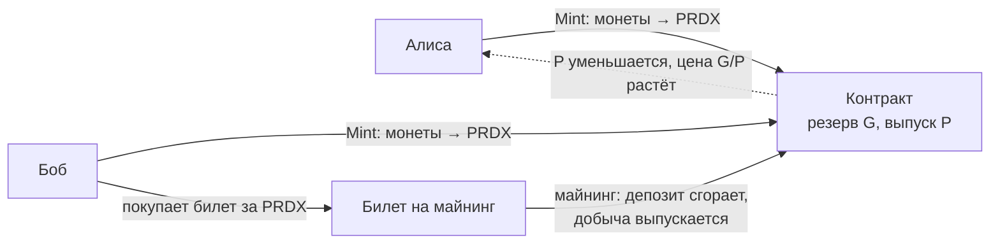
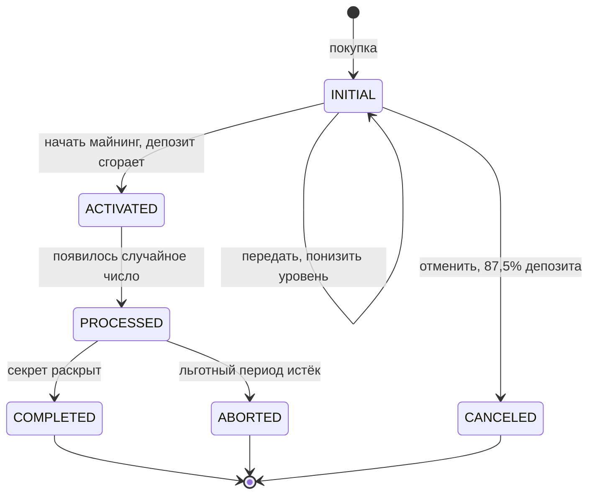
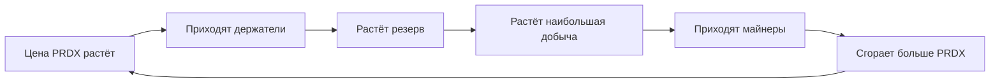
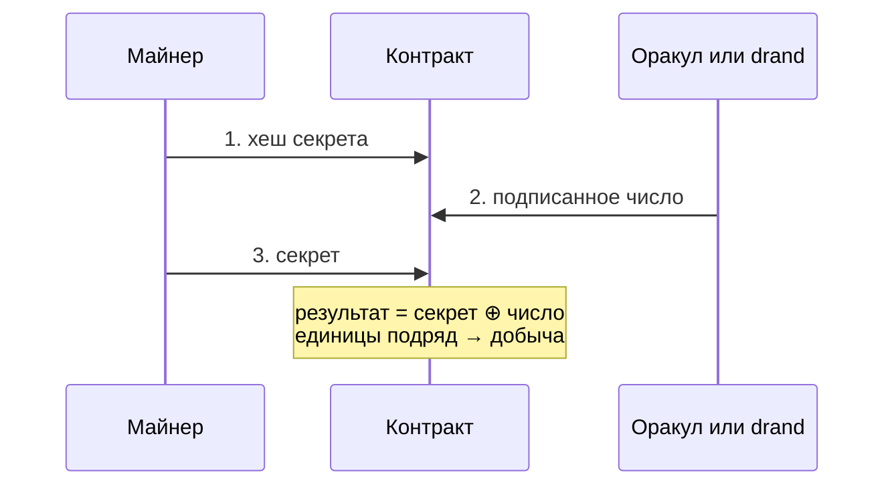

# PARADOX (PRDX)

> 🌐 **[English version](../en/docs.md)**

В документе описаны правила контрактов протокола PARADOX в сетях TON и Solana, их математика и результаты симуляций.

     

| Сеть | Резерв | Адрес |
|---|---|---|
| [TON testnet](https://testnet.tonviewer.com/kQDTGn-ZvqG33QAKWXSA5uVKHVgZ9xljk0fZAcIDPIbX9q1q) | Gram | `kQDTGn-ZvqG33QAKWXSA5uVKHVgZ9xljk0fZAcIDPIbX9q1q` |
| [TON testnet](https://testnet.tonviewer.com/kQCnJJvRzo20tFM2xlADW8g62yo0Q4ZFxqmo1TaTHDrVq7kH) | тестовый USDT | `kQCnJJvRzo20tFM2xlADW8g62yo0Q4ZFxqmo1TaTHDrVq7kH` |
| [Solana devnet](https://explorer.solana.com/address/GEnxVEpR9ALBhqhQPgPqeb59VAZS2JxTFt4hUArRD2yJ?cluster=devnet) | SOL | программа `GEnxVEpR9ALBhqhQPgPqeb59VAZS2JxTFt4hUArRD2yJ` |
| Solana devnet | USDT | та же программа, ещё не запущена |

> ⚠️ Протокол работает в тестовых сетях на токенах без реальной ценности. Не отправляйте в него средства из основной сети.

---

## Понять за минуту

PARADOX — протокол в блокчейнах TON и Solana. Его токен PRDX можно хранить или тратить на билеты на добычу (майнинг) новых токенов. Добыча случайна: она бывает во много раз больше цены билета, но в среднем меньше.

Получается парадокс: чем больше PRDX тратят на билеты, тем быстрее в среднем дорожает каждый PRDX. Зачем тогда покупать билеты, а не просто хранить PRDX? Ответ — в п. 6 и разделе 7. Почему растёт цена, описано в п. 1 и 4.

1. **Обеспечение.** PRDX полностью обеспечен резервом: цена PRDX равна резерву, делённому на число выпущенных PRDX. Выпуск за монеты (Mint) и обмен обратно на монеты (Burn) идут по этой цене и её не меняют, а Burn приостановить нельзя. В каждой паре сети и валюты резерва (TON: Gram, USDT; Solana: SOL, USDT) свой PRDX.
2. **Билет.** За PRDX покупают билет: право на добычу (майнинг) новых PRDX. Добыча считается по правилам Петербургской игры, задачи XVIII века, от парадокса которой протокол получил название (п. 3.1). Все варианты добычи с шансами известны до покупки. Добыча бывает во много раз больше цены билета.
3. **Средняя добыча.** Цена билета рассчитана так, что средняя добыча равна ровно 87,5% цены при любом уровне и любом числе попыток (п. 3.3).
4. **Дефляция.** В среднем остальные 12,5% сгорают, а резерв не меняется, поэтому майнинг сокращает выпуск PRDX и повышает их цену. Сгоревшее через рост цены получают все, у кого есть PRDX, пропорционально их числу. Протокол удерживает только комиссии Mint и Burn по 1,5625% (рисунок 5).
5. **Статистика.** По закону больших чисел чем больше билетов, тем ближе доля сгоревших PRDX к 12,5%, а по центральной предельной теореме отклонение убывает пропорционально $1/\sqrt{N}$, где $N$ — число билетов (раздел 6). Поэтому рост цены держится на статистике всех билетов, а не на удаче отдельного. Падение цены после крупной добычи ограничено лимитом (раздел 5). Симуляции [prdx-sim](https://github.com/prdx-admin/prdx-sim) по правилам контрактов совпадают с этим расчётом (рисунок 3). В симуляции при числе участников от 100 до 100 000 цена снижалась в 1–4% лет.
6. **Две стратегии.** Алиса хранит PRDX и получает рост цены. Боб тратит PRDX на билеты: в среднем он отдаёт 12,5% цены каждого билета, а взамен получает шанс на добычу, во много раз большую цены билета. Стратегии можно совмещать (раздел 7).
7. **Честность исхода.** Исход вычисляется из секрета майнера и случайного числа. В TON число присылает оракул, в Solana его публикует сеть drand. Майнер фиксирует секрет до появления числа, а источник числа видит только хеш секрета, поэтому ни майнер, ни источник числа исход не выбирают. Секрет и число записаны в блокчейне, и исход может пересчитать любой (раздел 9).
8. **Условия.** Цена растёт, только пока идёт майнинг, и выражена в монете резерва. Протокол работает в тестовых сетях на токенах без реальной ценности; риски собраны в разделе 12.

---

## Содержание

1. [Устройство протокола](#1-устройство-протокола)
2. [Цена PRDX, Mint и Burn](#2-цена-prdx-mint-и-burn)
3. [Билет на майнинг](#3-билет-на-майнинг)
4. [Действия с билетом](#4-действия-с-билетом)
5. [Лимит добычи](#5-лимит-добычи)
6. [Рост цены PRDX](#6-рост-цены-prdx)
7. [Стратегии Алисы и Боба](#7-стратегии-алисы-и-боба)
8. [Модель притока участников](#8-модель-притока-участников)
9. [Случайность майнинга](#9-случайность-майнинга)
10. [Контракты и параметры](#10-контракты-и-параметры)
11. [Как попробовать протокол](#11-как-попробовать-протокол)
12. [Риски](#12-риски)
13. [Частые вопросы](#13-частые-вопросы)
14. [Глоссарий](#14-глоссарий)

Графики построены в симуляторе [prdx-sim](https://github.com/prdx-admin/prdx-sim) по правилам контрактов.

---

## 1. Устройство протокола

Протокол работает в двух сетях: TON и Solana. Сети не связаны между собой. В каждой сети PRDX выпускается за две валюты:

| Сеть | Валюты |
|---|---|
| TON | Gram, USDT |
| Solana | SOL, USDT |

Каждая пара сети и валюты работает отдельно: у неё свой токен PRDX, свой резерв, своя цена и свои билеты. Например, PRDX, выпущенный в TON за Gram, нельзя обменять ни на PRDX, выпущенный в TON за USDT, ни на PRDX в Solana.

В главном контракте хранятся два числа:

| Обозначение | Что это |
|---|---|
| **G** | монеты в резерве |
| **P** | выпущенные PRDX |

Цена одного PRDX равна **G/P**.

С протоколом работают держатели и майнеры. В документе держателя зовут Алисой, майнера — Бобом.

**Алиса** получает PRDX за монеты и хранит их. **Боб** получает PRDX за монеты и покупает за них билеты на добычу PRDX.

Выпустить PRDX может только главный контракт. Он делает это в двух случаях: при Mint и при майнинге по билету. При **Mint** участник вносит монеты в резерв, и контракт выпускает ему PRDX по текущей цене G/P за вычетом комиссии. При **Burn** участник отправляет PRDX контракту, контракт сжигает их и выплачивает монеты из резерва по текущей цене G/P за вычетом комиссии. Mint и Burn меняют G и P в одной пропорции, поэтому цену они не меняют. На две комиссии по 1,5625% уходит около 3,1% суммы. Поэтому участник получает при Burn больше монет, чем внёс при Mint, только если рост цены между ними покроет обе комиссии. Комиссии защищают от арбитража вокруг чужого майнинга (п. 2.5).

Боб покупает билет за PRDX. Билет даёт право на добычу (майнинг) PRDX. Когда Боб начинает майнинг, контракт сжигает уплаченные PRDX, а в конце выпускает добычу новыми PRDX. Резерв при этом не меняется. Добыча в среднем равна 87,5% цены билета. Значит, в среднем PRDX после майнинга становится меньше при прежнем резерве, и цена G/P растёт.

Из средств участников протокол удерживает только комиссии Mint и Burn. Всё, что майнеры в среднем теряют на билетах, через рост цены получают все, у кого есть PRDX, в том числе Алиса, пропорционально их PRDX (рисунок 5). Эти свойства следуют из формулы цены билета (п. 3.3) и закона больших чисел (раздел 6).

---

## 2. Цена PRDX, Mint и Burn

Все примеры в документе приведены для сети TON и валюты Gram.

### 2.1. Цена

Цена PRDX равна резерву, делённому на выпуск:

$$
\text{цена PRDX} = \frac{G}{P}
$$

> **Пример.** В резерве 100 Gram, выпущено 10 000 PRDX. Один PRDX стоит 0,01 Gram, то есть 1 Gram = 100 PRDX. По этой цене контракты TON начали работу в тестовой сети.

### 2.2. Mint

Алиса вносит 10 Gram. В резерве 100 Gram, выпущено 10 000 PRDX.

1. Контракт откладывает комиссию 1,5625%, то есть 0,15625 Gram. Комиссия в резерв не входит: комиссии копятся в главном контракте отдельно, и их выводит управление (п. 10.1).
2. Остальные 9,84375 Gram поступают в резерв.
3. Контракт выпускает Алисе 984,375 PRDX по цене 0,01 Gram.

| | До | После |
|---|---|---|
| Выпуск **P** | 10 000 PRDX | 10 984,375 PRDX |
| Резерв **G** | 100 Gram | 109,84375 Gram |
| Цена **G/P** | 0,01 Gram | 0,01 Gram |

### 2.3. Burn

Burn превращает PRDX обратно в монеты резерва: так держатель забирает рост цены. Держатель отправляет на Burn 1 000 PRDX.

1. Контракт удерживает комиссию 1,5625%, то есть 15,625 PRDX. Эти PRDX не сгорают и остаются в выпуске.
2. Остальные 984,375 PRDX сгорают.
3. Держатель получает 9,84375 Gram из резерва.

| | До | После |
|---|---|---|
| Выпуск **P** | 10 000 PRDX | 9 015,625 PRDX |
| Резерв **G** | 100 Gram | 90,15625 Gram |
| Цена **G/P** | 0,01 Gram | 0,01 Gram |

Пока операция выполняется, цена может измениться из-за чужого майнинга. Поэтому в Mint и Burn передаётся допустимая просадка (slippage) от 0,1% до 100%. Если цена изменилась больше допустимой просадки, контракт отменяет операцию и возвращает средства.

### 2.4. Обмен PRDX на резерв

PRDX устроен как деньги при золотом стандарте: он полностью обеспечен резервом и обменивается на него по требованию. Отличие в курсе обмена: он не фиксирован, а равен G/P и в среднем растёт. Цена выражена в монете резерва, поэтому относительно других валют PRDX дорожает и дешевеет вместе с ней.

Биржа для PRDX не нужна: его выпускает сам участник, а Burn доступен в любой момент. Mint доступен, пока управление его не приостановило. Обе операции идут по цене G/P. При этом PRDX остаётся стандартным токеном: его баланс показывают обычные кошельки и обозреватели блоков, а переводить PRDX можно как любой токен сети.

### 2.5. Роль комиссий

Депозит билета сгорает в начале майнинга, а добыча выпускается после раскрытия секрета (п. 4.3). Между этими моментами цена PRDX выше, чем она будет после выпуска добычи. Без комиссий участник мог бы сделать Mint перед началом майнинга по чужому билету, а Burn до выпуска добычи и забрать часть роста цены, не рискуя. Снижение цены от выпуска добычи тогда пришлось бы на тех, кто хранит PRDX. С комиссиями такой круг окупается, только если сгоревший депозит поднимет цену больше, чем на две комиссии. При большом выпуске депозит обычного билета поднимает цену намного меньше.

---

## 3. Билет на майнинг

### 3.1. Петербургская игра

В 1713 году Николай Бернулли в письме к Пьеру Ремону де Монмору предложил задачу: игральную кость бросают, пока не выпадет шестёрка, а выплата растёт в прогрессии 1, 2, 4, 8, 16. В 1728 году Габриэль Крамер в письме к Николаю Бернулли записал ту же задачу с монетой. Задача вошла во второе издание книги Монмора о случайных играх (1713). В том же году Николай Бернулли издал «Искусство предположений» своего дяди Якоба Бернулли, где доказан закон больших чисел: чем больше испытаний, тем ближе частота события к его вероятности. На этом законе держится устойчивость роста цены PRDX (раздел 6).

Монету подбрасывают, пока не выпадет орёл. Если орёл выпал на первом броске, игрок получает 1 монету, на втором броске 2 монеты, на третьем 4 монеты. С каждым следующим броском выплата удваивается.

Математическое ожидание этой игры бесконечно:

$$
\mathbb{E} = \tfrac{1}{2}\cdot 1 + \tfrac{1}{4}\cdot 2 + \tfrac{1}{8}\cdot 4 + \ldots = \tfrac{1}{2} + \tfrac{1}{2} + \tfrac{1}{2} + \ldots = \infty
$$

При этом за участие в игре люди готовы заплатить лишь несколько монет. Крамер в 1728 году и Даниил Бернулли, двоюродный брат Николая, в 1738 году объяснили это расхождение убывающей полезностью денег. Статья Даниила Бернулли «Specimen theoriae novae de mensura sortis» («Опыт новой теории измерения риска») вышла в журнале Петербургской академии наук «Commentarii Academiae Scientiarum Imperialis Petropolitanae». В статье задача записана с монетой, и тем же доводом Бернулли разбирает, когда петербургскому купцу стоит страховать груз, который везут морем из Амстердама. По названию журнала игру называют Петербургской, а расхождение между ожиданием и ценой участия — Петербургским парадоксом. От него получил название и протокол PARADOX.

Провести исходную игру на деле нельзя: её выигрыш не ограничен, и выплатить его нечем. Добыча по билету PARADOX считается по тем же правилам, но число бросков ограничено уровнем билета, а майнинг начинается, только если наибольшая добыча не больше лимита (раздел 5). Резерв на добычу не расходуется: контракт выпускает её новыми PRDX, и цена каждого PRDX при этом снижается.

### 3.2. Правила майнинга

Правила майнинга открыты. Размер и вероятность каждого исхода записаны в контракте и известны до покупки билета.

Слово «майнинг» взято по сходству с биткойном: майнинг стоит денег, а добыча случайна. В остальном майнинг устроен иначе. В биткойне шанс майнера зависит от его доли вычислительной мощности сети, майнеры соревнуются за каждый блок, а майнинг подтверждает транзакции. В PARADOX шанс задан уровнем билета, добыча одного билета не зависит от других билетов, а транзакций майнинг не подтверждает.

У билета три параметра:

| В приложении | В формулах | Что задаёт | Допустимые значения | Зачем менять |
|---|---|---|---|---|
| **LVL** | $n$ | число возможных исходов попытки | от 2 до 32 | высокий LVL даёт редкую крупную добычу, низкий — добычу ближе к средней |
| **MIN** | $E$ | наименьшая добыча попытки | от 1 PRDX | масштаб билета: при том же LVL цена билета пропорциональна MIN |
| **DRAWS** | $a$ | число попыток | от 1 до 8 | больше попыток — добыча ближе к средней при том же депозите |

Майнинг по билету состоит из попыток. Попытка идёт так. Монету подбрасывают, пока не выпадет орёл, но не больше $n-1$ раз. Если орёл выпал на первом броске, добыча равна MIN. С каждым следующим броском добыча удваивается. Если за $n-1$ бросков орёл не выпал, добыча наибольшая:

$$
\text{MAX} = E \cdot 2^{\,n-1}
$$

Добыча исхода номер $k$ равна $E \cdot 2^{\,k-1}$, а его вероятность:

$$
p_k = \begin{cases}
\dfrac{1}{2^{\,k}}, & k = 1, \ldots, n-1 \\[6pt]
\dfrac{1}{2^{\,n-1}}, & k = n
\end{cases}
$$

> **Пример.** Билет LVL 6, MIN 4 PRDX, одна попытка. Билет стоит 16 PRDX.
>
> | Орёл выпал | Добыча | Вероятность |
> |---|---|---|
> | на 1-м броске | 4 | 50% |
> | на 2-м броске | 8 | 25% |
> | на 3-м броске | 16 | 12,5% |
> | на 4-м броске | 32 | 6,25% |
> | на 5-м броске | 64 | 3,125% |
> | не выпал за 5 бросков | 128 | 3,125% |

### 3.3. Цена билета

Цена билета называется **депозитом** $D$. Депозит рассчитывается по формуле, при которой средняя добыча равна 87,5% депозита. В контрактах эта доля записана параметром **RTP**:

$$
D = \frac{a \cdot E \cdot (n + 1)}{2 \cdot \text{RTP}},
\qquad
\mathbb{E}[\text{добыча}] = 0{,}875 \cdot D
$$

Формула верна для любого LVL и любого числа попыток: средняя добыча 87,5% — точное равенство, а не оценка. По билету из примера выше в среднем добывается $4 \cdot 7 / 2 = 14$ PRDX при депозите 16 PRDX. Остальные 12,5% депозита в среднем сгорают и повышают цену PRDX для всех, у кого есть PRDX. Для Боба это средняя потеря на каждом билете.

### 3.4. Средняя добыча и разброс

У билета два показателя, и оба известны до покупки.

**Средняя добыча** — 87,5% депозита при любых настройках (п. 3.3).

**Разброс** показывает, насколько добыча отдельного билета отличается от средней. Разброс задаётся уровнем и числом попыток (п. 3.5). С ростом уровня добыча больше депозита выпадает реже или так же часто, а редкая большая добыча становится крупнее. В таблице разброс измерен стандартным отклонением добычи билета с одной попыткой:

| LVL | MIN | MAX | Шанс добыть больше депозита | Шанс добыть MAX | Стандартное отклонение |
|---|---|---|---|---|---|
| 2 | 0,58·D | 1,17·D | 50% | 1 из 2 | 0,29·D |
| 4 | 0,35·D | 2,8·D | 25% | 1 из 8 | 0,80·D |
| 8 | 0,19·D | 25·D | 12,5% | 1 из 128 | 2,5·D |
| 12 | 0,13·D | 276·D | 12,5% | 1 из 2 048 | 7,4·D |
| 16 | 0,10·D | 3 373·D | 6,25% | 1 из 32 768 | 23·D |
| 24 | 0,07·D | 587 203·D | 6,25% | 1 из 8 388 608 | 248·D |

На LVL 2 добыча равна 0,58 или 1,17 депозита. На LVL 24 в 15 случаях из 16 добыча меньше депозита, а наибольшая добыча превышает депозит в 587 тысяч раз.

Рисунок 1 показывает добычу 10 000 майнеров с одинаковыми билетами. На LVL 2 больше депозита добывает каждый второй майнер, на LVL 24 — каждый шестнадцатый.

*Рисунок 1. 10 000 майнеров покупают одинаковый билет с одной попыткой. Столбик показывает долю майнеров с этой добычей, кружок — точную вероятность $2^{-k}$. Синим отмечена добыча больше депозита, оранжевым меньше. В заголовке панели указана точная доля билетов, по которым добывается больше депозита.*

### 3.5. Несколько попыток по одному билету

Несколько попыток выбирают, чтобы добыча билета была ближе к средней. Если DRAWS больше единицы, контракт проводит несколько попыток и складывает их добычу. Средняя добыча остаётся равной 87,5% депозита, а разброс при том же уровне и депозите уменьшается: при восьми попытках он почти втрое меньше, чем при одной. Наименьшая добыча билета равна $E \cdot a$. Наибольшая добыча билета при том же уровне и депозите не меняется, но выпадает намного реже: для неё MAX должен выпасть в каждой попытке.

---

## 4. Действия с билетом

### 4.1. Покупка билета

Боб покупает билет: депозит 32 PRDX, LVL 3, одна попытка. Контракт списывает 32 PRDX с кошелька Боба, но не сжигает их. До майнинга эти PRDX остаются в выпуске $P$. В билет записываются RTP и льготный период на момент покупки: если управление позже изменит их, для билета Боба останутся прежние значения. При покупке контракт проверяет, что MIN билета не меньше наименьшего MIN, а LVL не больше наибольшего LVL. Оба значения задаёт управление. Контракт проверяет их только при покупке, поэтому их изменение на купленный билет не влияет.

Купить билет можно, не начиная майнинг: например, чтобы подарить его или начать майнинг позже.

На TON билет — NFT. На Solana билет хранится в отдельном аккаунте программы.

### 4.2. Действия до майнинга

| Действие | Результат | Зачем |
|---|---|---|
| **Хранить** | ничего не меняется, срока у билета нет | начать майнинг позже, например когда лимит вырастет |
| **Передать** | билет переходит другому владельцу | подарить или продать билет |
| **Понизить уровень** (RESHAPE) | LVL уменьшается, MIN растёт или остаётся прежним; депозит, DRAWS и средняя добыча остаются прежними | начать майнинг по билету выше лимита |
| **Отменить** | Боб получает ровно 87,5% депозита, остальные 12,5% сгорают | вернуть PRDX, если Боб передумал майнить |
| **Начать майнинг** | депозит сгорает, начинается майнинг (п. 4.3) | получить добычу |

RESHAPE — стандартный способ начать майнинг по билету выше лимита добычи (раздел 5). Боб понижает уровень: при том же депозите MIN растёт, а MAX уменьшается, и билет проходит лимит. Средняя добыча остаётся равной 87,5% депозита. Контракт отклоняет RESHAPE, который повышает LVL или уменьшает MIN: так билет остаётся в условиях, проверенных при покупке. RESHAPE доступен почти всегда: на LVL 2 наибольшая добыча равна 1,17 депозита, поэтому лимит проходит любой билет с депозитом не больше примерно 10,7% выпуска.

Отмена эквивалентна майнингу по билету с одним исходом. При $n = 1$ формула депозита даёт единственную добычу $\text{RTP} \cdot D$, то есть те же 87,5%.

> **Пример.** Боб отменяет билет с депозитом 32 PRDX. Боб получает 28 PRDX, 4 PRDX сгорают.

### 4.3. Порядок майнинга

1. Боб отправляет хеш секрета. Контракт проверяет лимит добычи и сжигает депозит.
2. Появляется случайное число: в TON его присылает оракул, в Solana выходит раунд drand (п. 9.1). С этого момента идёт **льготный период**: время на раскрытие секрета. По умолчанию он длится 24 часа, в тестовой сети 5 минут.
3. Боб раскрывает секрет. Контракт вычисляет добычу и выпускает её целиком.

Если секрет не раскрыт до конца льготного периода, Боб может закрыть билет с наименьшей добычей $E \cdot a$: так билет закрывается, даже если секрет потерян.

Чем бы ни закончился билет, итог для выпуска один: депозит сожжён, а Бобу выпущены PRDX. При майнинге депозит сгорает в начале (шаг 1), при отмене — в момент отмены.

| Билет закончился | Боб получает |
|---|---|
| Боб раскрыл секрет | добычу по результату попыток |
| льготный период истёк | $E \cdot a$ |
| Боб отменил билет | 87,5% депозита |

---

## 5. Лимит добычи

Майнинг по билету начинается, только если наибольшая добыча билета не больше 12,5% выпуска. Купить билет выше лимита можно, а начать по нему майнинг нельзя. Контракт проверяет лимит, когда Боб начинает майнинг:

$$
E \cdot 2^{\,n-1} \cdot a \;\le\; 0{,}125 \cdot P
$$

Если билет прошёл проверку, контракт выпускает добычу целиком, даже если к концу майнинга выпуск изменился.

> **Пример.** Выпущено 100 000 PRDX, значит, наибольшая добыча билета не больше 12 500 PRDX. Боб хочет начать майнинг по билету с депозитом 1 000 PRDX на LVL 20. Наибольшая добыча такого билета составляет 43,7 млн PRDX, и контракт отклоняет операцию. Депозит не сгорает. Боб понижает уровень:
>
> | LVL | MIN | MAX | Проходит лимит |
> |---|---|---|---|
> | 20 | 83 | 43 690 000 | нет |
> | 9 | 175 | 44 800 | нет |
> | 7 | 219 | 14 000 | нет |
> | **6** | **250** | **8 000** | **да** |
>
> На LVL 6 билет проходит лимит, средняя добыча остаётся равной 87,5% депозита.

С ростом выпуска лимит растёт, и высокие уровни снова становятся доступны. Билет выше лимита можно хранить до этого момента или сразу перевести на допустимый уровень (RESHAPE, п. 4.2).

Лимит ограничивает падение цены после крупной добычи. Добычу размером 12,5% выпуска контракт выпускает новыми PRDX, и цена PRDX снижается примерно на 11%: $1 - 1/1{,}125 \approx 0{,}11$. Если крупная добыча выпадет по нескольким билетам одновременно, цена снизится сильнее.

Если майнинг продолжается, такое падение временно: майнинг остальных билетов в среднем снова сокращает выпуск, и цена растёт. В симуляции через два года после добычи 12,5% выпуска цена отстаёт от прогона без неё на 6% (рисунок 8a).

Рисунок 8d показывает, как лимит влияет на рост резерва и на падения цены.

---

## 6. Рост цены PRDX

Только майнинг и отмена билета меняют выпуск и не меняют резерв. При отмене сгорает ровно 12,5% депозита, при майнинге 12,5% сгорает в среднем. По отдельному билету выпуск может и вырасти: так бывает, когда добыча больше депозита.

> **Пример.** В резерве 1 000 Gram, выпущено 100 000 PRDX. За раунд майнеры в среднем сжигают 1 000 PRDX.
>
> | Раунд | Сожжено | Выпуск P | Резерв G | Цена 1 000 PRDX |
> |---|---|---|---|---|
> | 0 | — | 100 000 | 1 000 | 10,000 Gram |
> | 1 | 1 000 | 99 000 | 1 000 | 10,101 Gram |
> | 2 | 1 000 | 98 000 | 1 000 | 10,204 Gram |
> | 3 | 1 000 | 97 000 | 1 000 | 10,309 Gram |
>
> За три раунда 1 000 PRDX Алисы в среднем подорожали на 3,1%.

Пусть майнинг прошёл по билетам с суммой депозитов $V$, а в начале было выпущено $P_0$ PRDX. Если по билетам сгорела ровно средняя доля, то

$$
\frac{\text{цена}}{\text{начальная цена}} = \frac{1}{1 - 0{,}125 \cdot V/P_0}
$$

Если сумма депозитов равна начальному выпуску, цена вырастает в 1,14 раза. Если вдвое больше — в 1,33 раза.

*Рисунок 2. (a) Цена PRDX по мере майнинга по одинаковым билетам, 2 000 прогонов. Полоса каждого уровня охватывает 5–95% прогонов, пунктир показывает формулу роста. Разброс растёт с уровнем: полосы LVL 2–12 уже линии пунктира, полоса LVL 24 к концу расходится от 0,95 до 1,7. (b) Каждая точка показывает один год протокола с 10 000 участниками. Майнеры покупают от 0,25 до 8 билетов в месяц. Пунктир показывает ту же формулу для депозитов, которые растут вместе с выпуском: $\exp(0{,}125 \cdot \sum D/P)$. Большинство лет лежит выше пунктира. Точки правее и ниже облака показывают годы с крупной добычей: майнер снова тратит на билеты долю выросшего капитала, поэтому сумма депозитов растёт, а цена после крупной добычи ниже.*

Формула описывает средний результат. Фактический результат зависит от добычи по каждому билету, а по закону больших чисел чем больше билетов, тем ближе результат к формуле. По центральной предельной теореме доля сгоревших депозитов в раунде из $N$ одинаковых билетов отклоняется от 12,5% в пределах $\pm 2\sigma/\sqrt{N}$ примерно в 95% случаев, где $\sigma$ — стандартное отклонение добычи одного билета в долях депозита (п. 3.4). На LVL 4 уже 1 000 билетов сжигают долю депозитов, близкую к 12,5% (рисунок 3). В симуляции с числом участников от 100 до 100 000 цена PRDX снижалась в 1–4% лет.

*Рисунок 3. (a–c) Панели показывают долю депозитов, сгоревшую в раунде из $N$ одинаковых билетов. На LVL 4 достаточно 1 000 билетов, чтобы доля приблизилась к 12,5%. На LVL 24 не хватает и ста тысяч билетов: редкая крупная добыча сильно сдвигает результат. Пунктир показывает 12,5% ± 2σ/√N. (d) Панель показывает долю лет, в которые цена PRDX снизилась.*

---

## 7. Стратегии Алисы и Боба

### 7.1. Две крайние стратегии

Алиса и Боб действуют по двум крайним стратегиям. Участник может выбрать любую стратегию между ними: например, хранить большую часть PRDX и покупать билеты на остальные.

| | Алиса | Боб |
|---|---|---|
| Действия | получает PRDX за монеты и хранит | получает PRDX за монеты и покупает за них билеты |
| Доход | рост цены PRDX | добыча по билетам |
| Расход | комиссии Mint и Burn; падение цены после чужой крупной добычи | комиссии Mint и Burn; 12,5% каждого депозита в среднем |
| Результат | рост цены, пока другие участники майнят | шанс добыть сумму, кратную депозиту |

Экономисты Милтон Фридман и Леонард Сэвидж в 1948 году объяснили, почему один и тот же человек может одновременно страховаться от убытков и покупать лотерейные билеты. Участник протокола тоже может совмещать обе стратегии.

### 7.2. Как считается результат участника

Результат участника в монетах резерва без учёта комиссий Mint и Burn равен произведению двух множителей:

$$
\text{результат} = \underbrace{\frac{\text{цена в конце}}{\text{цена в начале}}}_{\text{одинаков для всех}} \times \underbrace{\frac{\text{PRDX в конце}}{\text{PRDX в начале}}}_{\text{свой у каждого}}
$$

Второй множитель зависит от двух решений участника.

**Сколько PRDX тратить на билеты.** На каждом билете участник в среднем теряет 12,5% депозита. Пусть участник покупает 24 билета в год и на каждый билет тратит одну и ту же долю PRDX, которые у него есть в этот момент. Сумма этих долей за год называется оборотом $T$.

| Доля PRDX на один билет | Оборот $T$ | PRDX через год, в среднем |
|---|---|---|
| 1/24 | 1 | 88% от начальных |
| 1/6 | 4 | 60% от начальных |

При любом числе билетов количество PRDX за год в среднем умножается примерно на $e^{-0{,}125\,T}$.

**Какой уровень выбирать.** Уровень не меняет средний результат, но меняет типичный. На низком уровне результат большинства участников близок к среднему. На высоком уровне большинство участников заканчивает год ниже среднего, а немногие добывают во много раз больше (рисунок 4a).

*Рисунок 4. Участник покупает за год 24 билета с одной попыткой. По горизонтали отложен оборот $T$, над столбцами указан точный средний множитель. Панели показывают: (a) медианный множитель PRDX, (b) шанс удвоить PRDX за год, %, (c) шанс потерять половину PRDX за год, %. Шанс удвоить PRDX выше всего на LVL 8–12 при обороте 2. Билеты низких уровней почти не дают удвоения, по билетам высоких уровней крупная добыча выпадает слишком редко.*

### 7.3. Профиль риска

В симуляции у каждого участника есть профиль риска ρ от 0 до 1. Участник с ρ = 0 действует как Алиса, участник с ρ = 1 — как Боб. С ростом ρ участник тратит на билеты большую долю PRDX, выбирает более высокий уровень и меньше попыток на билет. Участники разбиты на пять классов: Алиса (ρ = 0), три промежуточных класса и Боб (ρ от 0,75 до 1).

*Рисунок 5. Две модели участия. В верхнем ряду закрытое население: 20 000 участников, один год, 100 прогонов. В нижнем ряду модель притока (раздел 8): участники приходят и уходят, четыре года, 20 прогонов, ε = 0,8. (a, c) Панели показывают итог каждого класса участников и комиссии Mint и Burn в долях от всех внесённых монет. Сумма столбцов равна нулю: держатели получают то, что в среднем теряют майнеры, за вычетом комиссий. (b, d) Панели показывают распределение итогов внутри каждого класса. Ось идёт до наибольшего итога, точка отмечает наибольший итог класса.*

В симуляции держатели и участники с низким ρ в большинстве лет заканчивают год с прибылью. Участники с высоким ρ чаще теряют часть PRDX, но только среди них есть те, кто за год увеличил капитал в десять раз и больше. В модели притока держатели тоже получают прибыль, а все классы майнеров в среднем теряют, включая класс с ρ до 0,25. Майнер в этой модели уходит, когда у него остаётся меньше 20% принесённого, поэтому на панели (d) итоги майнеров начинаются около ×0,2. В обеих моделях наибольшие итоги отдельных майнеров превышают ×1000.

---

## 8. Модель притока участников

В этом разделе описана модель поведения участников. Модель не входит в правила контрактов. Результаты модели показывают возможную динамику протокола.

### 8.1. Связь держателей и майнеров

Наибольшая допустимая добыча билета равна 12,5% выпуска. В монетах резерва это 12,5% резерва. Новые держатели увеличивают резерв, а с ним растёт наибольшая добыча. Кук и Клотфелтер (Cook & Clotfelter, 1993) показали на лотереях штатов США, что билетов продаётся тем больше, чем крупнее главный приз. В модели так же ведут себя майнеры: они приходят тем чаще, чем больше наибольшая добыча. Новые майнеры сжигают больше PRDX, и цена растёт быстрее. В модели при быстром росте цены новые держатели приходят чаще.

Годовой рост цены для держателя примерно равен

$$
y \approx 0{,}125 \cdot \frac{V}{G}
$$

где $V$ обозначает сумму депозитов за год в монетах резерва по цене на момент покупки билетов, а $G$ обозначает резерв. Если держатели уходят, а майнеры остаются, те же 12,5% делятся на меньший резерв, и цена растёт быстрее. Тогда держатели снова приходят чаще. Если держателей становится слишком много, рост цены на каждого замедляется, и часть держателей уходит.

### 8.2. Предположения модели

| Параметр | Предположение |
|---|---|
| держатели | приходят тем чаще, чем сильнее $y$ превышает альтернативную доходность $r^*$ (5% годовых в базовом варианте) |
| майнеры | приходят тем чаще, чем больше наибольшая добыча; чувствительность ε показывает, на сколько процентов больше майнеров приходит при росте наибольшей добычи на 1% |
| стратегия майнера | у каждого майнера свой профиль риска ρ (п. 7.3): от него зависят доля PRDX на билеты, уровень и число попыток |
| уход | держатели уходят тем реже, чем сильнее $y$ превышает $r^*$; майнер уходит, когда у него остаётся меньше 20% принесённого |
| старт | 10 000 участников |

Если ε меньше 1, резерв растёт до устойчивого размера. Если ε больше 1, резерв растёт, пока на рынке есть новые участники.

### 8.3. Результаты симуляции притока

*Рисунок 6. Симуляция охватывает четыре года протокола, 20 прогонов. Панели показывают: (a) резерв, (b) цену PRDX, (c) годовой рост цены для держателя $y$, (d) долю майнеров. Серая линия показывает модель без обратной связи: участники приходят с постоянной скоростью. В этой модели резерв вырастает в 1,5 раза, а цена — в 2 раза, потому что 12,5% депозитов делятся на небольшой резерв. С обратной связью при ε = 0,5 и ε = 0,8 резерв вырастает в 5–9 раз, а цена — в 1,6–1,8 раза. При ε = 1,2 резерв вырастает в 37 раз, а цена — в 2,5 раза.*

*Рисунок 7. Каждая клетка построена по восьми прогонам. (a) Панель показывает, во сколько раз вырос резерв за четыре года: от ×1,0 до ×23. Резерв растёт быстрее при большем ε и меньшей альтернативной доходности $r^*$. (b) Панель показывает превышение роста цены над альтернативной доходностью в последний год, в процентных пунктах. При ε = 1,5 рост цены превышает альтернативную доходность при любом $r^*$ из диапазона, при ε = 1,25 — при $r^*$ до 20%. Пунктир отмечает ε = 1.*

*Рисунок 8. Каждый прогон с событием сравнивается с таким же прогоном без события, ε = 0,8. (a) На 730-й день один майнер добывает 12,5% выпуска. Цена падает примерно на 11% и к концу четвёртого года отстаёт от прогона без события на 6%. (b, c) На 730-й день уходит половина держателей. Рост цены для оставшихся держателей ускоряется, за полгода число держателей возвращается к 81% от прогона без события (медиана), а к концу четвёртого года — к 96%. (d) Панель показывает резерв через четыре года при разных лимитах добычи. Над столбцами указано типичное наибольшее однодневное падение цены. При лимите 12,5% резерв вырастает в 7,8 раза, а наибольшее однодневное падение составляет 8%.*

На рисунке 8d лимит 1,6% даёт однодневное падение 1%, но резерв почти не растёт. Лимит 25% даёт рост резерва в 19 раз и падение 7%.

---

## 9. Случайность майнинга

Результат майнинга зависит от двух чисел: секрета майнера и случайного числа. В TON случайное число присылает оракул, в Solana его публикует сеть drand.

$$
\text{результат} = \text{секрет майнера} \oplus \text{случайное число}
$$

Майнинг идёт по схеме commit-reveal:

1. **Майнер фиксирует секрет.** Начиная майнинг, майнер отправляет хеш SHA-256 секрета. После этого майнер не может заменить секрет: подобрать другой секрет с тем же хешем на практике невозможно.
2. **Появляется случайное число.** В TON в билет в начале майнинга записывается ключ оракула, и контракт принимает только число, подписанное этим ключом. В Solana в начале майнинга в билет записываются номер раунда drand и ключ сети drand (п. 9.1).
3. **Майнер раскрывает секрет.** Контракт сверяет секрет с хешем и вычисляет результат. Для каждой попытки контракт берёт 32 бита результата. Число единиц подряд, начиная с младшего бита, но не больше $n-1$, равно числу бросков до первого орла.

Ни майнер, ни источник числа не могут выбрать результат: секрет зафиксирован до появления числа, а источник числа видит только хеш секрета. Не раскрыть секрет майнеру тоже невыгодно: тогда билет закрывается с наименьшей добычей, а она не больше любого исхода.

После раскрытия секрет и случайное число записаны в блокчейне, и результат может пересчитать любой.

### 9.1. Раунды drand в Solana

drand — сеть независимых участников, которая каждые 3 секунды публикует случайное число очередного раунда. Число раунда — подпись BLS над его номером, собранная пороговым числом участников сети. У номера раунда одна верная подпись, поэтому сеть не выбирает число, а только публикует его.

1. **Начало майнинга.** Программа записывает в билет раунд, который выйдет не раньше чем через задержку развёртки (в тестовой сети 60 секунд), и ключ сети drand. Секрет майнера уже зафиксирован, а подписи этого раунда ещё нет.
2. **Раскрытие.** Майнер отправляет секрет вместе с подписью раунда. Программа проверяет подпись ключом, записанным в билет, и выводит из неё случайное число билета, привязанное к его номеру. Подпись чужого раунда или под другим ключом программа отвергает.
3. **Льготный период** отсчитывается от времени выхода раунда. После него билет закрывается с наименьшей добычей $E \cdot a$.

Число никто не доставляет: подпись раунда публикует сеть drand, и майнер прикладывает её к раскрытию, поэтому платы за доставку нет.

---

## 10. Контракты и параметры

### 10.1. Параметры протокола

Значения прочитаны из главных контрактов TON в тестовой сети.

| Параметр | Значение | Где действует |
|---|---|---|
| Комиссия Mint и Burn | 1,5625% | не входит в резерв |
| RTP | 87,5% | записывается в билет при покупке |
| Лимит добычи | 12,5% выпуска | проверяется в начале майнинга |
| Наименьший MIN | 1 PRDX | проверяется при покупке |
| Наибольший LVL | 24 (по умолчанию 32) | проверяется при покупке |
| DRAWS | от 1 до 8 | |
| Льготный период | 5 минут (по умолчанию 24 часа) | записывается в билет при покупке |

Управление — это адрес администратора главного контракта. Управление может менять комиссии, лимит и источник случайного числа (в TON ключ оракула, в Solana сеть drand), а для новых билетов RTP, льготный период, наименьший MIN и наибольший LVL. Комиссии копятся в главном контракте отдельно от резерва, и выводит их управление. Управление может приостановить Mint, покупку билетов и начало майнинга. Burn, раскрытие секрета, отмену, передачу билета и понижение уровня приостановить нельзя. Команды управления не меняют балансы PRDX. Лимит проверяется в начале майнинга, поэтому после его изменения купленному билету иногда нужен более низкий уровень (RESHAPE, п. 4.2).

### 10.2. Контракты TON

| Стандарт | Применение |
|---|---|
| **TEP-74** | PRDX и кошельки держателей |
| **TEP-89** | поиск адреса кошелька PRDX |
| **TEP-62** | билеты как NFT коллекции протокола |

Главный контракт выпускает PRDX, хранит резерв, ведёт коллекцию билетов и принимает команды управления. В TON работают два главных контракта: с резервом в Gram и с резервом в USDT (джеттон). У каждого держателя свой кошелёк PRDX, у каждого билета свой контракт.

### 10.3. Программа Solana

Программа Solana работает по тем же правилам. Передать билет на Solana можно командой программы, тоже только до майнинга. Случайное число в Solana даёт раунд сети drand, а не оракул (п. 9.1).

---

## 11. Как попробовать протокол

1. Откройте приложение в браузере, [app.prdxcoin.com](https://app.prdxcoin.com), или в Telegram, [@prdxcoinbot](https://t.me/prdxcoinbot). В Telegram доступны развёртки TON, в браузере — развёртки TON и Solana.
2. Включите режим **TRIAL**. В этом режиме приложение работает с тестовым балансом без кошелька: можно сделать Mint, купить билет и добыть по нему PRDX, посмотреть историю операций. Льготный период в TRIAL длится 1 минуту, остальные параметры совпадают с тестовой сетью.
3. Чтобы работать с тестовой сетью, откройте раздел **CONNECT**, выберите сеть и валюту резерва (в TON: Gram или USDT, в Solana: SOL) и подключите кошелёк. Тестовые монеты выдаёт кран соответствующей сети.
4. Плашка **HOW IT WORKS** на главном экране открывает вводное обучение: парадокс протокола и стратегии Алисы и Боба. Кнопка **?** в шапке приложения открывает подробное обучение по текущему разделу.

Сайт: [prdxcoin.com](https://prdxcoin.com/ru/) · приложение: [app.prdxcoin.com](https://app.prdxcoin.com), [@prdxcoinbot](https://t.me/prdxcoinbot) · канал: [t.me/prdxproject](https://t.me/prdxproject) · симулятор: [prdx-sim](https://github.com/prdx-admin/prdx-sim) · исходный текст документации: [prdx-docs](https://github.com/prdx-admin/prdx-docs)

---

## 12. Риски

- **Тестовая сеть.** Протокол экспериментальный и работает в тестовых сетях.
- **Средний результат билета.** Средняя добыча равна 87,5% депозита. На каждом билете участник в среднем теряет 12,5% депозита. Чем большую долю PRDX участник тратит на билеты, тем ниже его средний результат (п. 7.2).
- **Падение цены после крупной добычи.** Контракт выпускает добычу новыми PRDX, и цена снижается. Добыча, равная лимиту, снижает цену примерно на 11%. В симуляции такое падение временно: в закрытом населении цена снижалась в 1–4% лет, в модели притока — в 3 годах из 120 (разделы 5, 6 и 8). Если крупная добыча выпадает по нескольким билетам одновременно, цена снижается сильнее.
- **Зависимость от майнеров.** Цена растёт вместе с суммой депозитов (раздел 6). Если майнеров нет, цена не растёт.
- **Цена в монете резерва.** Цена PRDX выражена в монете резерва. Относительно других валют PRDX дорожает и дешевеет вместе с этой монетой.
- **Заморозка USDT.** USDT выпускает компания Tether, и она может заморозить USDT на любом адресе, в том числе на адресе резерва, например по требованию регулятора. Gram и SOL — монеты самих сетей, и заморозить их так нельзя.
- **Ошибки в контрактах.** Как у любого протокола в блокчейне, в контрактах могут быть ошибки.
- **Управление.** Управление меняет параметры протокола и может приостановить Mint, покупку билетов и начало майнинга. Burn приостановить нельзя. У купленного билета остаются прежние RTP и льготный период.

---

## 13. Частые вопросы

### 13.1. Какие комиссии у выпуска (Mint) и обмена (Burn) и зачем они?

По **1,5625%** с каждой операции. Комиссию Mint протокол берёт в монетах и не добавляет в резерв, а комиссию Burn берёт в PRDX и не сжигает. Цену PRDX обе операции не меняют. Комиссии защищают от арбитража. PRDX, уплаченные за билет, сгорают в начале майнинга, а добыча выпускается позже, и между этими моментами цена PRDX выше. Без комиссий участник мог бы купить PRDX перед началом майнинга по чужому билету и продать до выпуска добычи, а снижение цены от добычи пришлось бы на тех, кто хранит PRDX. С комиссиями продажа вернёт больше монет, чем внесено при покупке, только если рост цены PRDX между покупкой и продажей покроет обе комиссии.

### 13.2. Чем PRDX отличается от стейблкоинов?

Курс стейблкоина привязан к доллару или другой валюте. PRDX обеспечен резервом и обменивается на монеты резерва в любой момент, но его цена равна резерву, делённому на число выпущенных PRDX, и в среднем растёт, пока идёт майнинг. Цена PRDX выражена в монете резерва, поэтому к другим валютам она меняется вместе с этой монетой.

### 13.3. Чем PRDX отличается от пирамиды?

В пирамиде старым участникам платят деньгами новых, и выплаты прекращаются, когда новые перестают приходить. В PARADOX выпуск PRDX за монеты цену не меняет, поэтому приход новых участников сам по себе никому не платит. Цену PRDX поднимает только средняя недостача по билетам, и майнеры отдают её за шанс добыть во много раз больше. Если майнинг прекратится, цена PRDX перестанет расти, но не снизится. Все PRDX вместе обеспечены резервом, и обменять их на монеты резерва можно в любой момент по той же цене.

### 13.4. Нужна ли для PRDX биржа?

Нет: PRDX выпускает сам участник, когда вносит монеты в резерв, и в любой момент может обменять его обратно на монеты резерва. Обе операции идут по цене, равной резерву, делённому на число выпущенных PRDX. При этом PRDX остаётся обычным токеном сети: его показывают кошельки, и его можно переводить.

### 13.5. Связаны ли сети TON и Solana и валюты резерва?

Нет. В TON PRDX выпускается за Gram или USDT, в Solana за SOL или USDT, и каждая из четырёх пар работает отдельно: у неё свой PRDX, свой резерв, своя цена и свои билеты. PRDX одной пары нельзя обменять на PRDX другой.

### 13.6. В каком стандарте выпущены PRDX и билеты?

В TON PRDX выпускается по стандарту Jetton (TEP-74), а билет как NFT (TEP-62). В описании NFT записаны уровень и состояние билета, и кошельки TON показывают билет среди других NFT.

В Solana PRDX выпускается по стандарту SPL Token. Билет там не NFT: он хранится в отдельном аккаунте программы протокола, и передать его можно командой этой программы.

В обеих сетях билет можно передать другому владельцу только до начала майнинга.

### 13.7. Что такое майнинг PRDX?

Билет даёт право на добычу (майнинг) PRDX. Когда начинается майнинг, уплаченные за билет PRDX сгорают, а добычу протокол выпускает новыми PRDX. У билета три параметра:

- **LVL** от 2 до 32: число вариантов добычи.
- **MIN** от 1 PRDX: наименьшая добыча одной попытки.
- **DRAWS** от 1 до 8: число попыток.

В каждой попытке монету подбрасывают до орла, но не больше LVL − 1 раз, и с каждым броском без орла добыча удваивается. Средняя добыча равна **87,5%** цены билета при любых параметрах.

### 13.8. Кто определяет добычу и откуда слово «майнинг»?

Добычу не выбирает никто: она вычисляется из случайного числа майнера (секрета) и случайного числа извне. В TON это число присылает независимый сервис (оракул), в Solana его публикует сеть drand. Протокол записывает секрет в закрытом виде до появления этого числа. Майнер уже не может сменить секрет, а источник числа видит только его хеш. Оба числа хранятся в блокчейне, и добычу может пересчитать любой.

Слово «майнинг» взято по сходству с биткойном: майнинг стоит денег, а добыча случайна. В остальном майнинг устроен иначе: шансы заданы уровнем билета, добыча одного билета не зависит от других билетов, а транзакций майнинг не подтверждает.

### 13.9. Можно ли потерять PRDX на майнинге?

Да. В среднем билет возвращает 87,5% своей цены, то есть майнер теряет 12,5%. При одной попытке на высоком LVL добыча чаще всего меньше цены билета, а изредка во много раз больше: на LVL 24 добыча меньше цены билета в 15 случаях из 16, а наибольшая добыча больше цены в 587 тысяч раз.

### 13.10. Какой может быть добыча по одному билету?

До 12,5% всех выпущенных PRDX, то есть до девятой части резерва в монетах по цене после выпуска. Этот лимит растёт вместе с числом выпущенных PRDX: **чем больше PRDX выпущено, тем крупнее добыча, доступная по одному билету**.

Лимит защищает тех, кто хранит PRDX: добычу протокол выпускает новыми PRDX, и добыча, равная лимиту, снижает их цену примерно на 11%, не больше. Билет выше лимита можно купить сейчас и начать майнинг, когда PRDX станет больше, или понизить его уровень (RESHAPE).

### 13.11. Можно ли передумать после покупки билета?

Да, пока майнинг не начался. Билет можно отменить и получить ровно 87,5% его цены, остальные 12,5% сгорают. Ещё билет можно подарить или передать на другой адрес, а билет выше лимита можно перевести на более низкий уровень (RESHAPE).

### 13.12. Может ли цена PRDX снижаться?

Да. Добытые PRDX выпускает протокол, поэтому крупная добыча увеличивает число PRDX при прежнем резерве, и цена PRDX снижается, а крупная добыча по нескольким билетам сразу снижает её сильнее. Падение от одной добычи ограничено: не больше примерно 11%.

Если майнинг продолжается, такое падение временно: PRDX в среднем снова становится меньше, и цена PRDX растёт. В симуляциях prdx-sim цена PRDX снижалась в 1–4% лет при числе участников от 100 до 100 000 и в 3 годах из 120 в модели, где участники приходят и уходят.

### 13.13. Может ли кто-то заморозить или забрать мои PRDX?

Со стороны протокола нет. Управление протоколом не может менять балансы PRDX и не может приостановить Burn, поэтому обменять PRDX на монеты резерва можно всегда. Управление может приостановить Mint, покупку билетов и начало майнинга и менять параметры для новых билетов, а у купленного билета доля средней добычи остаётся прежней.

У резерва в USDT есть внешний риск: USDT выпускает компания Tether, и она может заморозить USDT на любом адресе, в том числе на адресе резерва, например по требованию регулятора. Gram и SOL — монеты самих сетей, и заморозить их так нельзя.

### 13.14. Какие риски у протокола?

- Протокол экспериментальный и работает в тестовых сетях.
- В среднем майнер теряет на билете 12,5% его цены.
- После крупной добычи цена PRDX снижается.
- Цена PRDX растёт, только пока идёт майнинг.
- Цена PRDX выражена в монете резерва и меняется к другим валютам вместе с ней.
- USDT в резерве может заморозить его эмитент, компания Tether; у резерва в Gram и SOL такого риска нет.

---

## 14. Глоссарий

| Термин | Значение |
|---|---|
| **PRDX** | токен протокола, обеспеченный резервом; в каждой сети за каждую валюту выпускается свой PRDX |
| **Резерв, G** | монеты на счёте главного контракта: Gram или USDT в TON, SOL или USDT в Solana |
| **Выпуск, P** | количество PRDX в обращении |
| **Цена PRDX** | G/P, цена одного PRDX в монете резерва |
| **Mint** | выпуск PRDX за монеты, внесённые в резерв, по текущей цене G/P |
| **Burn** | сжигание PRDX и выплата монет из резерва по текущей цене G/P |
| **Билет** | право добыть PRDX, купленное за PRDX; на TON — NFT |
| **Майнинг** | выпуск PRDX по билету: контракт сжигает депозит и выпускает добычу |
| **Попытка** | серия бросков монеты до первого орла, не больше $n-1$ бросков; у билета от 1 до 8 попыток |
| **Добыча** | PRDX, которые контракт выпускает по билету |
| **Депозит, D** | цена билета в PRDX |
| **LVL, n** | число возможных исходов попытки |
| **MIN, E** | наименьшая добыча одной попытки |
| **MAX** | наибольшая добыча одной попытки, $E \cdot 2^{n-1}$ |
| **DRAWS, a** | число попыток по билету |
| **RTP** | средняя добыча в доле депозита, 87,5% |
| **Разброс** | отличие добычи отдельного билета от средней; задаётся уровнем и числом попыток |
| **RESHAPE** | понижение уровня билета до майнинга при том же депозите; стандартный способ начать майнинг по билету выше лимита |
| **Лимит добычи** | условие начала майнинга: наибольшая добыча билета не больше 12,5% выпуска |
| **Льготный период** | время на раскрытие секрета после появления случайного числа |
| **Оракул** | сервис, который присылает подписанные случайные числа билетам в TON |
| **drand** | сеть, которая публикует подписанные случайные числа раундами; источник случайного числа в Solana |
| **Управление** | адрес администратора главного контракта: меняет параметры, выводит комиссии, может приостановить Mint, покупку билетов и начало майнинга |
| **Оборот, T** | сумма долей PRDX участника, потраченных на билеты за год |

---

## Дисклеймер

В документе описано текущее состояние протокола PARADOX. Актуальные значения параметров хранятся в контрактах.

Документ — не финансовая рекомендация. PARADOX — экспериментальный протокол в тестовых сетях. Участник может потерять часть или все вложенные средства. Взаимодействуя с протоколом, вы подтверждаете, что:

- понимаете математическую модель протокола и её риски;
- используете тестовые токены без реальной ценности;
- сами отвечаете за свои решения;
- авторы документации не отвечают за убытки от использования протокола.
