# PARADOX (PRDX)

> 🌐 **[English version](../en/docs.md)**

В документе описаны правила контрактов протокола PARADOX в сетях TON и Solana, их математика и результаты симуляций.

[Сайт](https://prdxcoin.com/ru/) · [Веб-приложение](https://app.prdxcoin.com) · [Telegram-приложение](https://t.me/prdxcoinbot) · [Симулятор](https://github.com/prdx-admin/prdx-sim/blob/main/ru.md) · [Новости](https://t.me/prdxproject) · [Чат](https://t.me/prdxcoinchat) · [X](https://x.com/prdxdev)

| Сеть | Резерв | Адрес |
|---|---|---|
| [TON testnet](https://testnet.tonviewer.com/kQBeEa5i2tk7tJ1da3fZhfAlvyZ1uHQ0ohlV2wno6-e8shkE) | Gram | `kQBeEa5i2tk7tJ1da3fZhfAlvyZ1uHQ0ohlV2wno6-e8shkE` |
| [TON testnet](https://testnet.tonviewer.com/kQDDo6XTGKxsheZY6Xi2n09h9thuyMdzGhfMoR4sOwnamzpY) | тестовый USDT | `kQDDo6XTGKxsheZY6Xi2n09h9thuyMdzGhfMoR4sOwnamzpY` |
| [Solana devnet](https://explorer.solana.com/address/GEnxVEpR9ALBhqhQPgPqeb59VAZS2JxTFt4hUArRD2yJ?cluster=devnet) | SOL | программа `GEnxVEpR9ALBhqhQPgPqeb59VAZS2JxTFt4hUArRD2yJ` |
| Solana devnet | USDT | та же программа, ещё не запущена |

> ⚠️ Протокол работает в тестовых сетях на токенах без реальной ценности. Не отправляйте в него средства из основной сети. Дату запуска основной сети объявим в [X](https://x.com/prdxdev) и в [Telegram](https://t.me/prdxproject).

---

## Понять за минуту

PARADOX — протокол в блокчейнах TON и Solana. Его токен PRDX можно хранить или тратить на билеты на добычу (майнинг) новых токенов. Добыча случайна: она бывает во много раз больше цены билета, но в среднем меньше.

Получается парадокс: чем больше PRDX тратят на билеты, тем быстрее в среднем дорожает каждый PRDX. Зачем тогда покупать билеты, а не просто хранить PRDX? Ответ — в пункте 6 этого списка и в разделе 7. Почему растёт цена, описано в пунктах 1 и 4.

1. **Обеспечение.** PRDX полностью обеспечен резервом: цена PRDX равна резерву, делённому на число выпущенных PRDX. Выпуск за монеты (Mint) и обмен обратно на монеты (Burn) идут по этой цене и её не меняют, а Burn приостановить нельзя. В каждой паре сети и валюты резерва (TON: Gram, USDT; Solana: SOL, USDT) свой PRDX.
2. **Билет.** За PRDX покупают билет: право на добычу (майнинг) новых PRDX. Добыча устроена как Петербургская игра, задача XVIII века, от парадокса которой протокол получил название (п. 3.1). Все варианты добычи с шансами известны до покупки. Добыча бывает во много раз больше цены билета.
3. **Средняя добыча.** Цена билета рассчитана так, что средняя добыча равна 87,5% цены при любом уровне и любом числе попыток (п. 3.3).
4. **Дефляция.** В среднем остальные 12,5% сгорают, а резерв не меняется, поэтому майнинг сокращает выпуск PRDX и повышает их цену. Сгоревшее через рост цены получают все, у кого есть PRDX, пропорционально их числу. Протокол удерживает только комиссии Mint и Burn по 1,5625% (рисунок 5).
5. **Статистика.** По закону больших чисел чем больше билетов, тем ближе доля сгоревших PRDX к 12,5%, а по центральной предельной теореме отклонение убывает пропорционально $`1/\sqrt{N}`$, где $`N`$ — число билетов (раздел 6). Поэтому рост цены держится на статистике всех билетов, а не на удаче отдельного. Падение цены после добычи одной попытки ограничено лимитом (раздел 5). Симуляции [prdx-sim](https://github.com/prdx-admin/prdx-sim) по правилам контрактов совпадают с этим расчётом (рисунок 3). В симуляции цена за год снижалась в 7,7% лет при 100 участниках и в 1% лет при 100 000 участников (рисунок 3d).
6. **Две стратегии.** Алиса хранит PRDX и получает рост цены. Боб тратит PRDX на билеты: в среднем он отдаёт 12,5% цены каждого билета, а взамен получает шанс на добычу, во много раз большую цены билета. Стратегии можно совмещать (раздел 7).
7. **Честность исхода.** Исход вычисляется из секрета майнера и случайного числа. В TON число присылает оракул, в Solana его публикует сеть drand. Майнер фиксирует секрет до появления числа, а источник числа видит только хеш секрета, поэтому ни майнер, ни источник числа исход не выбирают. Секрет и число записаны в блокчейне, и исход может пересчитать любой (раздел 9).
8. **Условия.** Цена растёт, только пока идёт майнинг, и выражена в монете резерва. Протокол работает в тестовых сетях на токенах без реальной ценности; риски собраны в разделе 12.

---

## Содержание

1. [Устройство протокола](#1-устройство-протокола)
2. [Цена PRDX, Mint и Burn](#2-цена-prdx-mint-и-burn)
3. [Билет на майнинг](#3-билет-на-майнинг)
4. [Действия с билетом](#4-действия-с-билетом)
5. [Лимит добычи](#5-лимит-добычи)
6. [Рост цены PRDX](#6-рост-цены-prdx)
7. [Стратегии Алисы и Боба](#7-стратегии-алисы-и-боба)
8. [Модель притока участников](#8-модель-притока-участников)
9. [Случайность майнинга](#9-случайность-майнинга)
10. [Контракты, параметры и SDK](#10-контракты-параметры-и-sdk)
11. [Как попробовать протокол](#11-как-попробовать-протокол)
12. [Риски](#12-риски)
13. [Частые вопросы](#13-частые-вопросы)
14. [Глоссарий](#14-глоссарий)

Графики построены в симуляторе [prdx-sim](https://github.com/prdx-admin/prdx-sim) по правилам контрактов.

---

## 1. Устройство протокола

Протокол работает в двух сетях: TON и Solana. Сети не связаны между собой. В каждой сети PRDX выпускается за две валюты:

| Сеть | Валюты |
|---|---|
| TON | Gram, USDT |
| Solana | SOL, USDT |

Каждая пара сети и валюты работает отдельно: у неё свой токен PRDX, свой резерв, своя цена и свои билеты. Например, PRDX, выпущенный в TON за Gram, нельзя обменять ни на PRDX, выпущенный в TON за USDT, ни на PRDX в Solana.

В главном контракте хранятся два числа:

| Обозначение | Что это |
|---|---|
| **G** | монеты в резерве |
| **P** | выпущенные PRDX |

Цена одного PRDX равна **G/P**.

С протоколом работают держатели и майнеры. В документе держателя зовут Алисой, майнера — Бобом.

**Алиса** получает PRDX за монеты и хранит их. **Боб** получает PRDX за монеты и покупает за них билеты на добычу PRDX.

Выпустить PRDX может только главный контракт. Он делает это в двух случаях: при Mint и при майнинге по билету. При **Mint** участник вносит монеты в резерв, и контракт выпускает ему PRDX по текущей цене G/P за вычетом комиссии. При **Burn** участник отправляет PRDX контракту, контракт сжигает их и выплачивает монеты из резерва по текущей цене G/P за вычетом комиссии. Mint и Burn меняют G и P в одной пропорции, поэтому цену они не меняют. На две комиссии по 1,5625% уходит около 3,1% суммы. Поэтому участник получает при Burn больше монет, чем внёс при Mint, только если рост цены между ними покроет обе комиссии. Комиссии защищают от арбитража вокруг чужого майнинга (п. 2.5).

Билет покупается за PRDX и даёт право на добычу (майнинг) PRDX. В начале майнинга контракт сжигает уплаченные PRDX, кроме части, равной наименьшей добыче. В конце майнинга владелец билета получает добычу: эту часть и новые PRDX сверх неё. Резерв при этом не меняется. Добыча в среднем равна 87,5% цены билета, поэтому в среднем PRDX после майнинга становится меньше при прежнем резерве, и цена G/P растёт.

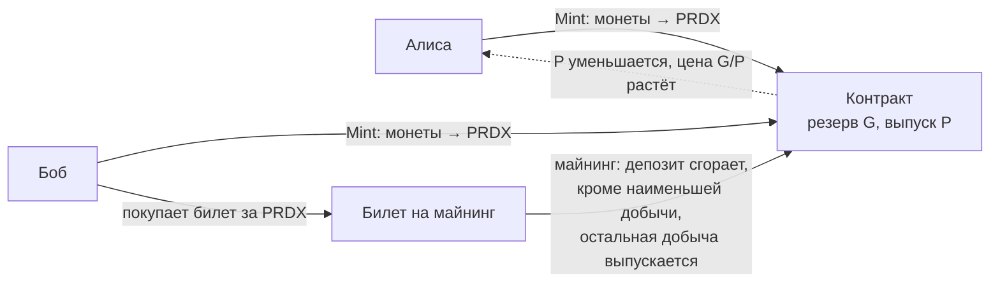

Из средств участников протокол удерживает только комиссии Mint и Burn. Всё, что майнеры в среднем теряют на билетах, через рост цены получают все, у кого есть PRDX, в том числе Алиса, пропорционально их PRDX (рисунок 5). Эти свойства следуют из формулы цены билета (п. 3.3) и закона больших чисел (раздел 6).

---

## 2. Цена PRDX, Mint и Burn

Все примеры в документе приведены для сети TON и валюты Gram.

### 2.1. Цена

Цена PRDX равна резерву, делённому на выпуск:

```math
\text{цена PRDX} = \frac{G}{P}
```

> **Пример.** В резерве 100 Gram, выпущено 10 000 PRDX. Один PRDX стоит 0,01 Gram, то есть 1 Gram = 100 PRDX. По этой цене контракты TON начали работу в тестовой сети.

### 2.2. Mint

Алиса вносит 10 Gram. В резерве 100 Gram, выпущено 10 000 PRDX.

1. Контракт откладывает комиссию 1,5625%, то есть 0,15625 Gram. Комиссия в резерв не входит: комиссии копятся в главном контракте отдельно, и их выводит управление (п. 10.1).
2. Остальные 9,84375 Gram поступают в резерв.
3. Контракт выпускает Алисе 984,375 PRDX по цене 0,01 Gram.

| | До | После |
|---|---|---|
| Выпуск **P** | 10 000 PRDX | 10 984,375 PRDX |
| Резерв **G** | 100 Gram | 109,84375 Gram |
| Цена **G/P** | 0,01 Gram | 0,01 Gram |

### 2.3. Burn

Burn превращает PRDX обратно в монеты резерва: так держатель забирает рост цены. Держатель отправляет на Burn 1 000 PRDX.

1. Контракт удерживает комиссию 1,5625%, то есть 15,625 PRDX. Эти PRDX не сгорают и остаются в выпуске.
2. Остальные 984,375 PRDX сгорают.
3. Держатель получает 9,84375 Gram из резерва.

| | До | После |
|---|---|---|
| Выпуск **P** | 10 000 PRDX | 9 015,625 PRDX |
| Резерв **G** | 100 Gram | 90,15625 Gram |
| Цена **G/P** | 0,01 Gram | 0,01 Gram |

Пока операция выполняется, цена может измениться из-за чужого майнинга. Поэтому в Mint и Burn передаётся допустимая просадка (slippage) от 0,1% до 100%. Если цена изменилась больше допустимой просадки, контракт отменяет операцию и возвращает средства.

### 2.4. Обмен PRDX на резерв

PRDX устроен как деньги при золотом стандарте: он полностью обеспечен резервом и обменивается на него по требованию. Отличие в курсе обмена: он не фиксирован, а равен G/P и в среднем растёт. Цена выражена в монете резерва, поэтому относительно других валют PRDX дорожает и дешевеет вместе с ней.

Биржа для PRDX не нужна: его выпускает сам участник, а Burn доступен в любой момент. Mint доступен, пока управление его не приостановило. Обе операции идут по цене G/P. При этом PRDX остаётся стандартным токеном: его баланс показывают обычные кошельки и обозреватели блоков, а переводить PRDX можно как любой токен сети.

### 2.5. Роль комиссий

Депозит билета сгорает в начале майнинга, кроме наименьшей добычи, а остальная добыча выпускается после раскрытия секрета (п. 4.3). Между этими моментами цена PRDX не ниже, чем она будет после выпуска добычи. Без комиссий участник мог бы сделать Mint перед началом майнинга по чужому билету, а Burn до выпуска добычи и забрать часть роста цены, не рискуя. Снижение цены от выпуска добычи тогда пришлось бы на тех, кто хранит PRDX. С комиссиями такой круг окупается, только если сгоревшая часть депозита поднимет цену больше, чем на две комиссии. При большом выпуске депозит обычного билета поднимает цену намного меньше.

---

## 3. Билет на майнинг

### 3.1. Петербургская игра

В 1713 году Николай Бернулли в письме к Пьеру Ремону де Монмору предложил задачу: игральную кость бросают, пока не выпадет шестёрка, а выплата растёт в прогрессии 1, 2, 4, 8, 16. Задача вошла во второе издание книги Монмора о случайных играх (1713). В том же году Николай Бернулли издал «Искусство предположений» своего дяди Якоба Бернулли, где доказан закон больших чисел: чем больше испытаний, тем ближе частота события к его вероятности. На этом законе держится устойчивость роста цены PRDX (раздел 6). В 1728 году Габриэль Крамер в письме к Николаю Бернулли записал ту же задачу с монетой.

Монету подбрасывают, пока не выпадет орёл. Если орёл выпал на первом броске, игрок получает 1 монету, на втором броске 2 монеты, на третьем 4 монеты. С каждым следующим броском выплата удваивается.

Математическое ожидание этой игры бесконечно:

```math
\mathbb{E} = \tfrac{1}{2}\cdot 1 + \tfrac{1}{4}\cdot 2 + \tfrac{1}{8}\cdot 4 + \ldots = \tfrac{1}{2} + \tfrac{1}{2} + \tfrac{1}{2} + \ldots = \infty
```

При этом за участие в игре люди готовы заплатить лишь несколько монет. Крамер в 1728 году и Даниил Бернулли, двоюродный брат Николая, в 1738 году объяснили это расхождение убывающей полезностью денег. Статья Даниила Бернулли «Specimen theoriae novae de mensura sortis» («Опыт новой теории измерения риска») вышла в журнале Петербургской академии наук «Commentarii Academiae Scientiarum Imperialis Petropolitanae». В статье задача записана с монетой, и тем же доводом Бернулли разбирает, когда петербургскому купцу стоит страховать груз, который везут морем из Амстердама. По названию журнала игру называют Петербургской, а расхождение между ожиданием и ценой участия — Петербургским парадоксом. От него получил название и протокол PARADOX.

Провести исходную игру на деле нельзя: её выигрыш не ограничен, и выплатить его нечем. Добыча по билету PARADOX устроена так же, но число бросков ограничено уровнем билета, а майнинг начинается, только если наибольшая добыча попытки не больше лимита (раздел 5). Резерв на добычу не расходуется: она увеличивает выпуск PRDX, и цена каждого PRDX при этом снижается.

### 3.2. Правила майнинга

Правила майнинга открыты. Размер и вероятность каждого исхода записаны в контракте и известны до покупки билета.

Слово «майнинг» взято по сходству с биткойном: майнинг стоит денег, а добыча случайна. В остальном майнинг устроен иначе. В биткойне шанс майнера зависит от его доли вычислительной мощности сети, майнеры соревнуются за каждый блок, а майнинг подтверждает транзакции. В PARADOX шанс задан уровнем билета, добыча одного билета не зависит от других билетов, а транзакций майнинг не подтверждает.

У билета три параметра:

| В приложении | В формулах | Что задаёт | Допустимые значения | Зачем менять |
|---|---|---|---|---|
| **LVL** | $`n`$ | число возможных исходов попытки | от 2 до 24 (теоретически до 32) | высокий LVL даёт редкую крупную добычу, низкий — добычу ближе к средней |
| **MIN** | $`E`$ | наименьшая добыча попытки | от 1 PRDX | масштаб билета: при том же LVL цена билета пропорциональна MIN |
| **DRAWS** | $`a`$ | число попыток | от 1 до 8 | купить $`a`$ попыток одной транзакцией (п. 3.5) |

Майнинг по билету состоит из попыток. Попытка идёт так. Монету подбрасывают, пока не выпадет орёл, но не больше $`n-1`$ раз. Если орёл выпал на первом броске, добыча равна MIN. С каждым следующим броском добыча удваивается. Если за $`n-1`$ бросков орёл не выпал, добыча наибольшая:

```math
\text{MAX} = E \cdot 2^{\,n-1}
```

Добыча исхода номер $`k`$ равна $`E \cdot 2^{\,k-1}`$, а его вероятность:

```math
p_k = \begin{cases}
\dfrac{1}{2^{\,k}}, & k = 1, \ldots, n-1 \\[6pt]
\dfrac{1}{2^{\,n-1}}, & k = n
\end{cases}
```

> **Пример.** Билет LVL 6, MIN 4 PRDX, одна попытка. Билет стоит 16 PRDX.
>
> | Орёл выпал | Добыча | Вероятность |
> |---|---|---|
> | на 1-м броске | 4 | 50% |
> | на 2-м броске | 8 | 25% |
> | на 3-м броске | 16 | 12,5% |
> | на 4-м броске | 32 | 6,25% |
> | на 5-м броске | 64 | 3,125% |
> | не выпал за 5 бросков | 128 | 3,125% |

### 3.3. Цена билета

Цена билета называется **депозитом** $`D`$. Депозит рассчитывается по формуле, при которой средняя добыча равна 87,5% депозита. В контрактах эта доля записана параметром **RTP**:

```math
D = \frac{a \cdot E \cdot (n + 1)}{2 \cdot \text{RTP}},
\qquad
\mathbb{E}[\text{добыча}] = 0{,}875 \cdot D
```

Формула верна для любого LVL и любого числа попыток. Контракт округляет депозит каждой попытки вниз до наименьшей единицы PRDX, поэтому средняя добыча равна 87,5% депозита с точностью до этой единицы. По билету из примера выше в среднем добывается $`4 \cdot 7 / 2 = 14`$ PRDX при депозите 16 PRDX. Остальные 12,5% депозита в среднем сгорают и повышают цену PRDX для всех, у кого есть PRDX. Для владельца билета это средняя потеря на билете.

### 3.4. Средняя добыча и разброс

У билета два показателя, и оба известны до покупки.

**Средняя добыча** — 87,5% депозита при любых настройках (п. 3.3).

**Разброс** показывает, насколько добыча отдельного билета отличается от средней. Разброс задаётся уровнем и числом попыток (п. 3.5). С ростом уровня добыча больше депозита выпадает реже или так же часто, а редкая большая добыча становится крупнее. В таблице разброс измерен стандартным отклонением добычи билета с одной попыткой:

| LVL | MIN | MAX | Шанс добыть больше депозита | Шанс добыть MAX | Стандартное отклонение |
|---|---|---|---|---|---|
| 2 | 0,58·D | 1,17·D | 50% | 1 из 2 | 0,29·D |
| 4 | 0,35·D | 2,8·D | 25% | 1 из 8 | 0,80·D |
| 8 | 0,19·D | 25·D | 12,5% | 1 из 128 | 2,5·D |
| 12 | 0,13·D | 276·D | 12,5% | 1 из 2 048 | 7,4·D |
| 16 | 0,10·D | 3 373·D | 6,25% | 1 из 32 768 | 23·D |
| 24 | 0,07·D | 587 203·D | 6,25% | 1 из 8 388 608 | 248·D |

На LVL 2 добыча равна 0,58 или 1,17 депозита. На LVL 24 в 15 случаях из 16 добыча меньше депозита, а наибольшая добыча превышает депозит в 587 тысяч раз.

Рисунок 1 показывает вероятность каждой добычи. На LVL 2 добыча больше депозита выпадает в половине случаев, на LVL 24 — в одном случае из 16.

<p align="center">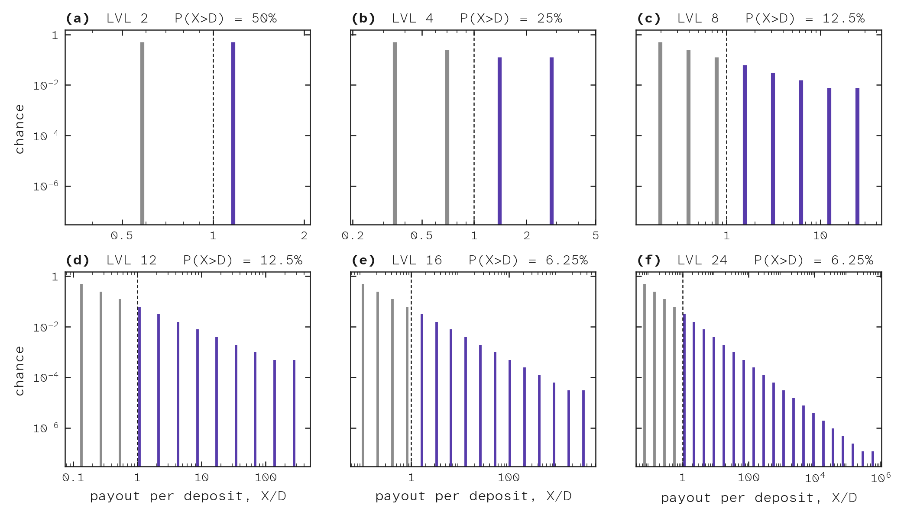</p>

*Рисунок 1. Билет с одной попыткой. По горизонтали отложена добыча в долях депозита, по вертикали — её вероятность $`2^{-k}`$. Наибольшая добыча выпадает с той же вероятностью, что и предыдущая. Добыча больше депозита выделена цветом, добыча меньше депозита — серым. В заголовке панели указана вероятность добычи больше депозита.*

### 3.5. Билет с несколькими попытками

Билет с DRAWS $`a`$ заменяет $`a`$ билетов с одной попыткой и теми же LVL и MIN и покупается одной транзакцией, а не $`a`$ транзакциями.

| | Билет с DRAWS $`a`$ | $`a`$ билетов с одной попыткой |
|---|---|---|
| депозит | $`D = a \cdot E \cdot (n+1) / (2 \cdot \text{RTP})`$ | $`D/a`$ у каждого |
| добыча | сумма добычи $`a`$ попыток | сумма добычи $`a`$ билетов |
| наименьшая добыча | $`E \cdot a`$ | $`E`$ у каждого |
| возврат при отмене | $`a \cdot \lfloor \text{RTP} \cdot D/a \rfloor`$ | $`\lfloor \text{RTP} \cdot D/a \rfloor`$ у каждого |
| лимит (раздел 5) | MAX одной попытки не больше 12,5% выпуска | MAX каждого билета не больше 12,5% выпуска |
| секрет и случайное число | общие для всех попыток | у каждого билета свои |
| передача, RESHAPE, отмена | только всего билета | каждого билета отдельно |
| комиссия сети за действие | один раз | $`a`$ раз |

---

## 4. Действия с билетом

### 4.1. Покупка билета

При покупке контракт списывает депозит с кошелька покупателя, но не сжигает его: до майнинга эти PRDX остаются в выпуске $`P`$. В билет записываются RTP и льготный период на момент покупки, и их изменение управлением на купленный билет не влияет. Контракт проверяет, что MIN билета не меньше наименьшего MIN, а LVL не больше наибольшего LVL. Оба значения задаёт управление, и контракт проверяет их только при покупке.

Майнинг начинается в той же транзакции, что и покупка, или позже отдельным действием.

> **Пример.** Боб покупает билет: депозит 32 PRDX, LVL 3, одна попытка. С кошелька Боба списываются 32 PRDX, выпуск $`P`$ не меняется.

На TON билет — NFT. На Solana билет хранится в отдельном аккаунте программы.

### 4.2. Действия до майнинга

| Действие | Результат | Зачем |
|---|---|---|
| **Хранить** | ничего не меняется, срока у билета нет | начать майнинг позже, например когда лимит вырастет |
| **Передать** | билет переходит другому владельцу | подарить или продать билет |
| **Понизить уровень** (RESHAPE) | LVL уменьшается, MIN растёт или остаётся прежним; депозит и DRAWS остаются прежними | начать майнинг по билету выше лимита |
| **Отменить** | владелец получает 87,5% депозита, остальные 12,5% сгорают | вернуть PRDX без майнинга |
| **Начать майнинг** | депозит сгорает, кроме наименьшей добычи, начинается майнинг (п. 4.3) | получить добычу |

RESHAPE задаёт билету новые LVL и MIN, пока майнинг не начался. Контракт принимает новую пару, только если LVL не больше прежнего, MIN не меньше прежнего, а цена билета с новой парой не больше депозита. Если цена меньше депозита, остаток депозита сгорает в начале майнинга. Средняя добыча равна 87,5% депозита, если MIN наибольший из допустимых при новом LVL; такой MIN предлагает приложение. На LVL 2 MAX попытки равен $`1{,}17 \cdot D/a`$, где $`D/a`$ — депозит одной попытки, поэтому после RESHAPE до LVL 2 лимит проходит любой билет, у которого $`D/a`$ не больше примерно 10,7% выпуска.

Отмена эквивалентна майнингу по билету с одним исходом. При $`n = 1`$ формула депозита даёт единственную добычу $`\text{RTP} \cdot D`$, то есть те же 87,5%. Возврат равен $`a \cdot \lfloor \text{RTP} \cdot D/a \rfloor`$ наименьших единиц PRDX: контракт округляет вниз возврат каждой из $`a`$ попыток (п. 3.5).

> **Пример.** Боб отменяет билет с депозитом 32 PRDX. Боб получает 28 PRDX, 4 PRDX сгорают.

### 4.3. Порядок майнинга

1. Владелец билета отправляет хеш секрета. Контракт проверяет лимит добычи и сжигает депозит, кроме наименьшей добычи $`E \cdot a`$: её владелец получит при любом исходе.
2. Появляется случайное число: в TON его присылает оракул, в Solana выходит раунд drand (п. 9.1). С этого момента идёт **льготный период**: время на раскрытие секрета. По умолчанию он длится 24 часа, в тестовой сети 5 минут.
3. Владелец раскрывает секрет. Контракт вычисляет добычу, передаёт её владельцу целиком и выпускает добычу сверх наименьшей.

Владелец может закрыть билет с наименьшей добычей $`E \cdot a`$, если льготный период истёк, а секрет не раскрыт. Так закрывается и билет с потерянным секретом. В TON владелец может закрыть билет с наименьшей добычей и раньше, пока оракул не прислал случайное число. Новые PRDX при закрытии не выпускаются.

Чем бы ни закончился билет, итог для выпуска один: депозит сожжён, а владельцу выпущены PRDX. При майнинге депозит, кроме наименьшей добычи, сгорает в начале (шаг 1), а наименьшая добыча остаётся в выпуске до закрытия билета; при отмене депозит сгорает в момент отмены.

| Билет закончился | Владелец получает |
|---|---|
| секрет раскрыт | добычу по результату попыток |
| льготный период истёк, билет закрыт | $`E \cdot a`$ |
| в TON случайное число не пришло, билет закрыт | $`E \cdot a`$ |
| билет отменён | 87,5% депозита |

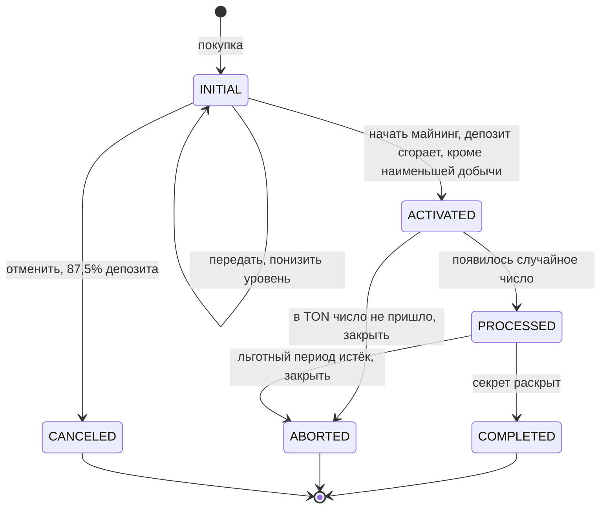

---

## 5. Лимит добычи

Майнинг по билету начинается, только если MAX одной попытки не больше 12,5% выпуска. Купить билет выше лимита можно, а начать по нему майнинг нельзя. Контракт проверяет лимит в начале майнинга:

```math
E \cdot 2^{\,n-1} \;\le\; 0{,}125 \cdot P
```

Число попыток $`a`$ в условие не входит. У всех попыток билета одни и те же MIN и LVL, и условие сравнивает с лимитом MAX одной попытки, как у билета с одной попыткой (п. 3.5).

Если билет прошёл проверку, контракт передаёт владельцу билета добычу целиком, даже если к концу майнинга выпуск изменился.

> **Пример.** Выпущено 100 000 PRDX, значит, лимит равен 12 500 PRDX. Боб хочет начать майнинг по билету с депозитом 1 000 PRDX на LVL 20 с одной попыткой. MAX такого билета составляет 43,7 млн PRDX, и контракт отклоняет операцию. Депозит не сгорает. Боб понижает уровень:
>
> | LVL | MIN | MAX | Проходит лимит |
> |---|---|---|---|
> | 20 | 83 | 43 690 000 | нет |
> | 9 | 175 | 44 800 | нет |
> | 7 | 219 | 14 000 | нет |
> | **6** | **250** | **8 000** | **да** |
>
> На LVL 6 билет проходит лимит, средняя добыча остаётся равной 87,5% депозита.
>
> Если Боб выберет тот же депозит и DRAWS 8, на каждую попытку придётся 125 PRDX. На LVL 10 MIN равен 19,9 PRDX, MAX попытки равен 10 182 PRDX, и билет проходит лимит. На LVL 11 MAX попытки равен 18 667 PRDX, больше лимита.

С ростом выпуска лимит растёт, и высокие уровни снова становятся доступны. Билет выше лимита можно хранить до этого момента или сразу перевести на допустимый уровень (RESHAPE, п. 4.2).

Лимит ограничивает падение цены после крупной добычи. Добыча попытки размером 12,5% выпуска увеличивает число PRDX в 1,125 раза при прежнем резерве, и цена PRDX снижается примерно на 11%: $`1 - 1/1{,}125 \approx 0{,}11`$. Если крупная добыча выпадет по нескольким билетам или в нескольких попытках одного билета, цена снизится сильнее. Билет с $`a`$ попытками добывает до $`a`$ лимитов, если MAX выпадет во всех попытках.

Если майнинг продолжается, на остальных билетах в среднем снова сгорает больше PRDX, чем выпускается, и цена в среднем растёт. В симуляции через два года после добычи 12,5% выпуска цена отстаёт от прогона без неё на 3% (рисунок 8a).

Рисунок 8d показывает, как лимит влияет на рост резерва и на падения цены.

---

## 6. Рост цены PRDX

Только майнинг и отмена билета меняют выпуск и не меняют резерв. При отмене сгорает 12,5% депозита, при майнинге 12,5% сгорает в среднем. По отдельному билету выпуск может и вырасти: так бывает, когда добыча больше депозита.

> **Пример.** В резерве 1 000 Gram, выпущено 100 000 PRDX. За раунд майнеры в среднем сжигают 1 000 PRDX.
>
> | Раунд | Сожжено | Выпуск P | Резерв G | Цена 1 000 PRDX |
> |---|---|---|---|---|
> | 0 | — | 100 000 | 1 000 | 10,000 Gram |
> | 1 | 1 000 | 99 000 | 1 000 | 10,101 Gram |
> | 2 | 1 000 | 98 000 | 1 000 | 10,204 Gram |
> | 3 | 1 000 | 97 000 | 1 000 | 10,309 Gram |
>
> За три раунда 1 000 PRDX Алисы в среднем подорожали на 3,1%.

Пусть майнинг прошёл по билетам с суммой депозитов $`V`$, в начале было выпущено $`P_0`$ PRDX, и за это время не было ни Mint, ни Burn: выпуск менялся только в майнинге, а майнеры снова вносили полученную добычу. Сумма $`V`$ считается в PRDX и поэтому может превышать выпуск. Если по билетам сгорела ровно средняя доля, то

```math
\frac{\text{цена}}{\text{начальная цена}} = \frac{1}{1 - 0{,}125 \cdot V/P_0}
```

Если сумма депозитов равна начальному выпуску, цена вырастает в 1,14 раза. Если вдвое больше — в 1,33 раза.

Число участников в формулу не входит: важны только депозиты и выпуск. Mint и Burn меняют выпуск, поэтому в общем случае рост считается по выпуску на момент каждого депозита: цена в среднем умножается на $`\exp(0{,}125 \cdot \sum D/P)`$. Те же депозиты при вдвое большем выпуске поднимают цену в 1,07 раза, при вдвое меньшем в 1,33 раза.

<p align="center">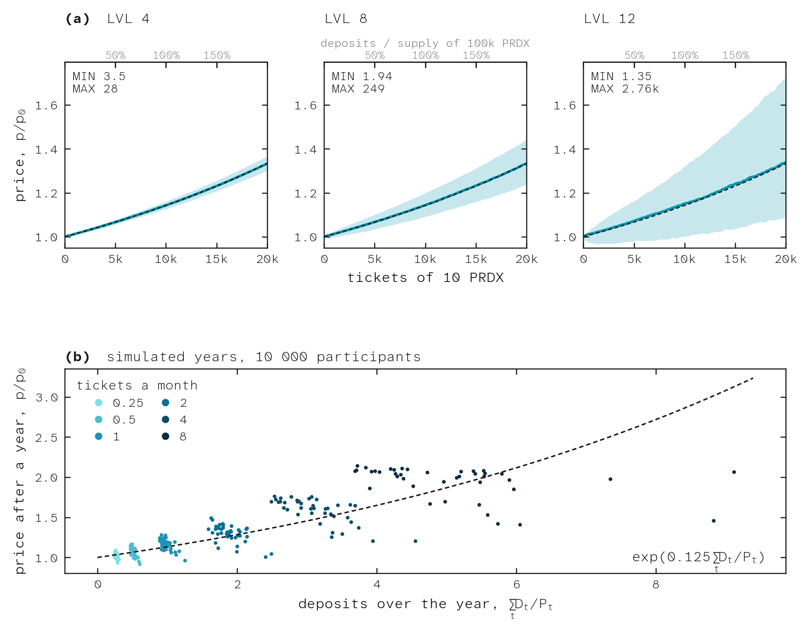</p>

*Рисунок 2. (a) Пример из этого раздела: выпущено 100 000 PRDX, Mint и Burn нет, майнеры покупают билеты с одной попыткой по 10 PRDX, 2 000 прогонов. По горизонтали отложено число билетов, на верхней шкале — сумма их депозитов в долях начального выпуска. В углу панели указаны MIN и MAX билета. Линия показывает медиану, полоса охватывает 5–95% прогонов, пунктир показывает формулу. На каждом уровне цена растёт с числом билетов: после 20 000 билетов сумма депозитов вдвое больше выпуска, и медиана равна 1,33. Разброс растёт с уровнем: после 20 000 билетов полоса LVL 4 лежит в пределах 1,30–1,37, полоса LVL 12 — от 1,09 до 1,73. При билете 10 PRDX лимит допускает уровни до LVL 14 при выпуске 100 000 PRDX и до LVL 13 при медианном выпуске после 20 000 билетов, 75 000 PRDX. (b) Каждая точка показывает один год протокола с 10 000 участниками. Майнеры покупают от 0,25 до 8 билетов в месяц. Пунктир показывает ту же формулу для депозитов, которые растут вместе с выпуском: $`\exp(0{,}125 \cdot \sum D/P)`$. Выше пунктира лежат 69% лет. Точки правее и ниже облака показывают годы с крупной добычей: майнер снова тратит на билеты долю выросшего капитала, поэтому сумма депозитов растёт, а цена после крупной добычи ниже.*

Формула описывает средний результат. Фактический результат зависит от добычи по каждому билету, а по закону больших чисел чем больше билетов, тем ближе результат к формуле. По центральной предельной теореме доля сгоревших депозитов в раунде из $`N`$ одинаковых билетов отклоняется от 12,5% в пределах $`\pm 2\sigma/\sqrt{N}`$ примерно в 95% случаев, где $`\sigma`$ — стандартное отклонение добычи одного билета в долях депозита (п. 3.4). На LVL $`n`$ оценка выполняется, когда $`N`$ больше $`2^{n}`$: при меньшем $`N`$ результат раунда зависит от редкой крупной добычи (рисунок 3). На LVL 4 уже 1 000 билетов сжигают долю депозитов, близкую к 12,5% (рисунок 3). В симуляции цена за год снижалась в 7,7% лет при 100 участниках и в 1% лет при 100 000 участников (рисунок 3d).

<p align="center">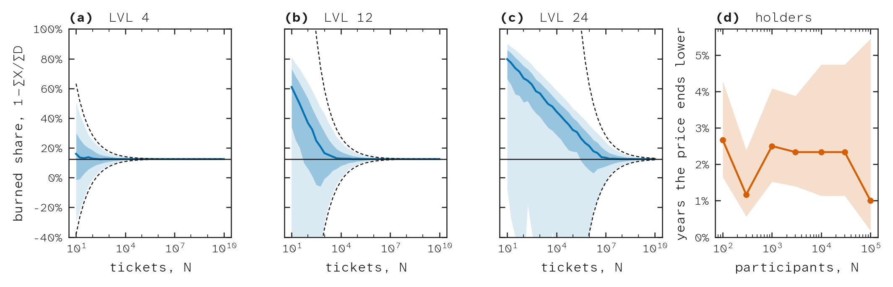</p>

*Рисунок 3. (a–c) Панели показывают долю депозитов, сгоревшую в раунде из $`N`$ одинаковых билетов. Ось доходит до $`10^{10}`$ билетов. На LVL 4 достаточно 1 000 билетов, чтобы доля приблизилась к 12,5%. На LVL 24 доля приближается к 12,5% только после $`2^{24}`$, около 17 миллионов билетов: до этого редкая крупная добыча сильно сдвигает результат. Пунктир показывает 12,5% $`\pm 2\sigma/\sqrt{N}`$. (d) Панель показывает долю лет, в которые цена PRDX снизилась, в закрытом населении из $`N`$ участников. До 3 000 участников точка построена по 600 годам, при 10 000 и 30 000 по 300, при 100 000 по 100. Полоса показывает 95-процентный интервал Уилсона.*

---

## 7. Стратегии Алисы и Боба

### 7.1. Две крайние стратегии

Алиса и Боб действуют по двум крайним стратегиям. Участник может выбрать любую стратегию между ними: например, хранить большую часть PRDX и покупать билеты на остальные.

| | Алиса | Боб |
|---|---|---|
| Действия | получает PRDX за монеты и хранит | получает PRDX за монеты и покупает за них билеты |
| Доход | рост цены PRDX | добыча по билетам |
| Расход | комиссии Mint и Burn; падение цены после чужой крупной добычи | комиссии Mint и Burn; 12,5% каждого депозита в среднем |
| Результат | рост цены, пока другие участники майнят | шанс добыть во много раз больше депозита |

### 7.2. Как считается результат участника

Результат участника в монетах резерва без учёта комиссий Mint и Burn равен произведению двух множителей:

```math
\text{результат} = \underbrace{\frac{\text{цена в конце}}{\text{цена в начале}}}_{\text{одинаков для всех}} \times \underbrace{\frac{\text{PRDX в конце}}{\text{PRDX в начале}}}_{\text{свой у каждого}}
```

Второй множитель зависит от двух решений участника.

**Сколько PRDX тратить на билеты.** На каждом билете участник в среднем теряет 12,5% депозита. Пусть участник покупает 24 билета в год и на каждый билет тратит одну и ту же долю PRDX, которые у него есть в этот момент. Сумма этих долей за год называется оборотом $`T`$.

| Доля PRDX на один билет | Оборот $`T`$ | PRDX через год, в среднем |
|---|---|---|
| 1/24 | 1 | 88% от начальных |
| 1/6 | 4 | 60% от начальных |

При любом числе билетов количество PRDX за год в среднем умножается примерно на $`e^{-0{,}125\,T}`$.

**Какой уровень выбирать.** Уровень не меняет средний результат, но меняет типичный. На низком уровне результат большинства участников близок к среднему. На высоком уровне большинство участников заканчивает год ниже среднего, а немногие добывают во много раз больше (рисунок 4a).

<p align="center">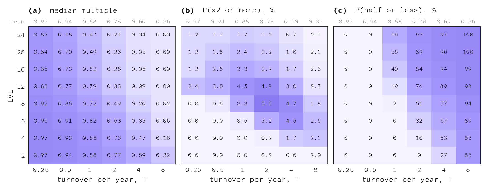</p>

*Рисунок 4. Участник покупает за год 24 билета с одной попыткой. По горизонтали отложен оборот $`T`$, над столбцами указан точный средний множитель. Панели показывают: (a) медианный множитель PRDX, (b) шанс удвоить PRDX за год, %, (c) шанс потерять половину PRDX за год, %. Шанс удвоить PRDX выше всего на LVL 8–12 при обороте 2. Билеты низких уровней почти не дают удвоения, по билетам высоких уровней крупная добыча выпадает слишком редко.*

### 7.3. Профиль риска

В симуляции у каждого участника есть профиль риска $`\rho`$ от 0 до 1. Участник с $`\rho = 0`$ действует как Алиса, участник с $`\rho = 1`$ — как Боб. С ростом $`\rho`$ участник тратит на билеты большую долю PRDX, выбирает более высокий уровень и меньше попыток на билет. Участники разбиты на пять классов: Алиса ($`\rho = 0`$), три промежуточных класса и Боб ($`\rho`$ от 0,75 до 1).

<p align="center">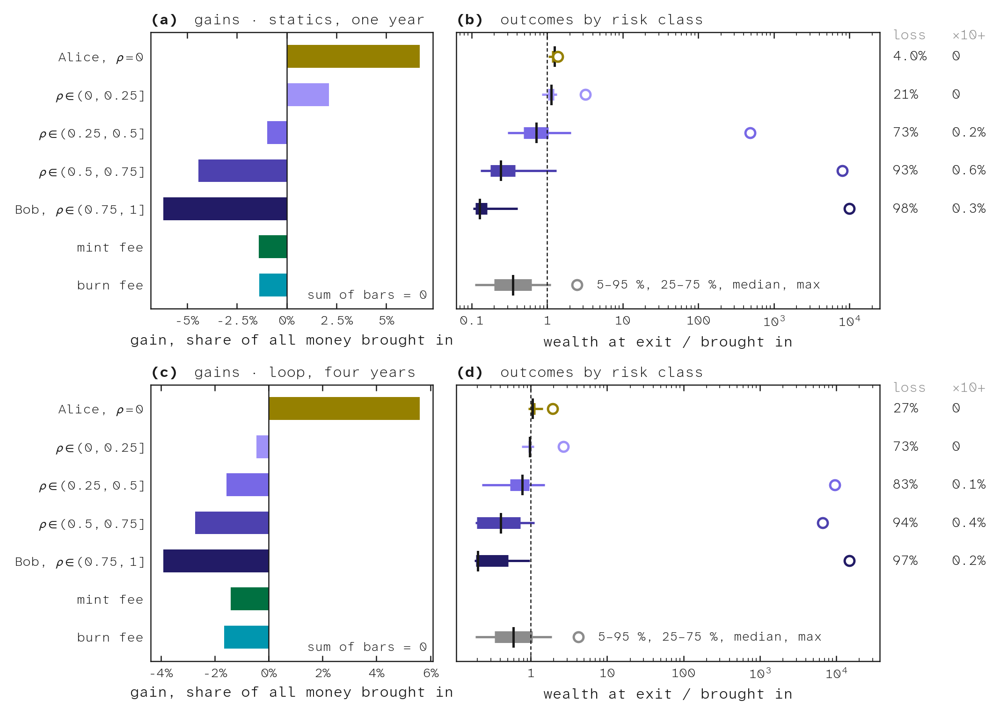</p>

*Рисунок 5. Две модели участия. В верхнем ряду закрытое население: 20 000 участников, один год, 100 прогонов. В нижнем ряду модель притока (раздел 8): участники приходят и уходят, четыре года, 20 прогонов, $`\varepsilon = 0{,}8`$. (a, c) Панели показывают выигрыш каждого класса участников и комиссии Mint и Burn в долях от всех внесённых монет. Сумма столбцов равна нулю: держатели получают то, что в среднем теряют майнеры, за вычетом комиссий. (b, d) Итог участника равен капиталу при выходе, делённому на внесённый. Справа указаны доля класса с убытком и доля с итогом ×10 и больше.*

В симуляции держатели и участники с низким $`\rho`$ в большинстве лет заканчивают год с прибылью. Участники с высоким $`\rho`$ чаще теряют часть PRDX, но итог ×10 и больше бывает только у классов с $`\rho`$ выше 0,25. В модели притока держатели тоже получают прибыль, а все классы майнеров в среднем теряют, включая класс с $`\rho`$ до 0,25. Майнер в этой модели уходит, когда у него остаётся меньше 20% принесённого, поэтому на панели (d) итоги майнеров начинаются около ×0,2. В обеих моделях наибольшие итоги отдельных майнеров превышают ×1000.

---

## 8. Модель притока участников

В этом разделе описана модель поведения участников. Модель не входит в правила контрактов. Результаты модели показывают возможную динамику протокола.

### 8.1. Связь держателей и майнеров

Наибольшая допустимая добыча одной попытки равна 12,5% выпуска. По цене до выпуска добычи это 12,5% резерва в монетах. Новые держатели увеличивают резерв, а с ним растёт наибольшая добыча. Кук и Клотфелтер (Cook & Clotfelter, 1993) показали на лотереях штатов США, что билетов продаётся тем больше, чем крупнее главный приз. В модели так же ведут себя майнеры: они приходят тем чаще, чем больше наибольшая добыча. Новые майнеры сжигают больше PRDX, и цена растёт быстрее. В модели при быстром росте цены новые держатели приходят чаще.

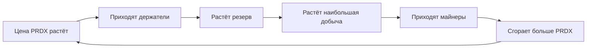

Годовой рост цены для держателя примерно равен

```math
y \approx 0{,}125 \cdot \frac{V}{G}
```

где $`V`$ обозначает сумму депозитов за год в монетах резерва по цене на момент покупки билетов, а $`G`$ обозначает резерв. Если держатели уходят, а майнеры остаются, те же 12,5% делятся на меньший резерв, и цена растёт быстрее. Тогда держатели снова приходят чаще. Если держателей становится слишком много, рост цены на каждого замедляется, и часть держателей уходит.

### 8.2. Предположения модели

| Параметр | Предположение |
|---|---|
| держатели | приходят тем чаще, чем сильнее $`y`$ превышает альтернативную доходность $`r^*`$ (5% годовых в базовом варианте) |
| майнеры | приходят тем чаще, чем больше наибольшая добыча; чувствительность $`\varepsilon`$ показывает, на сколько процентов больше майнеров приходит при росте наибольшей добычи на 1% |
| стратегия майнера | у каждого майнера свой профиль риска $`\rho`$ (п. 7.3): от него зависят доля PRDX на билеты, уровень и число попыток |
| уход | держатели уходят тем реже, чем сильнее $`y`$ превышает $`r^*`$; майнер уходит, когда у него остаётся меньше 20% принесённого |
| старт | 10 000 участников |

Если $`\varepsilon`$ меньше 1, резерв растёт до устойчивого размера. Если $`\varepsilon`$ больше 1, резерв растёт, пока на рынке есть новые участники.

### 8.3. Результаты симуляции притока

<p align="center">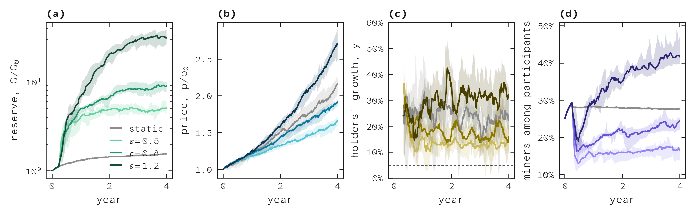</p>

*Рисунок 6. Симуляция охватывает четыре года протокола, 20 прогонов. Панели показывают: (a) резерв, (b) цену PRDX, (c) годовой рост цены для держателя $`y`$, (d) долю майнеров. Серая линия показывает модель без обратной связи: участники приходят с постоянной скоростью. Чем больше $`\varepsilon`$, тем темнее линия. Линия показывает медиану, полоса — межквартильный размах. В модели без обратной связи резерв вырастает в 1,55 раза, а цена — в 2,2 раза, потому что 12,5% депозитов делятся на небольшой резерв. С обратной связью при $`\varepsilon = 0{,}5`$ резерв вырастает в 5,0 раза, а цена в 1,66 раза. При $`\varepsilon = 0{,}8`$ резерв вырастает в 8,9 раза, а цена в 1,92 раза. При $`\varepsilon = 1{,}2`$ резерв вырастает в 31 раз (межквартильный размах 27–38), а цена — в 2,7 раза. Пунктир на панели (c) отмечает альтернативную доходность $`r^*`$ = 5%. В прогонах с обратной связью, 240 лет, цена за год снизилась дважды, оба раза при $`\varepsilon = 0{,}5`$.*

<p align="center">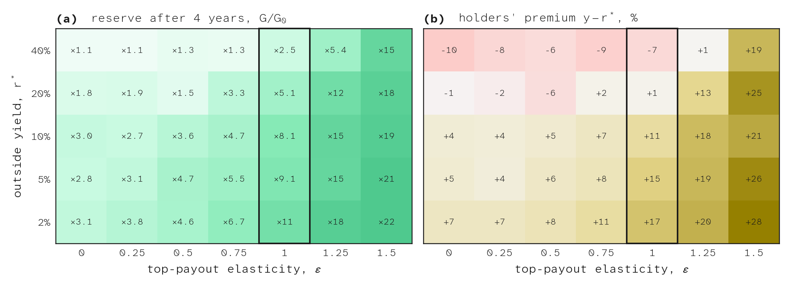</p>

*Рисунок 7. Каждая клетка показывает медиану восьми прогонов. (a) Панель показывает, во сколько раз вырос резерв за четыре года: от ×1,1 до ×22. Резерв растёт быстрее при большем $`\varepsilon`$ и меньшей альтернативной доходности $`r^*`$. (b) Панель показывает превышение роста цены над альтернативной доходностью в последний год, в процентных пунктах. При $`\varepsilon = 1{,}25`$ и $`\varepsilon = 1{,}5`$ рост цены превышает альтернативную доходность при любом $`r^*`$ из диапазона, при меньших $`\varepsilon`$ — при $`r^*`$ до 10%. Рамка отмечает $`\varepsilon = 1`$.*

<p align="center">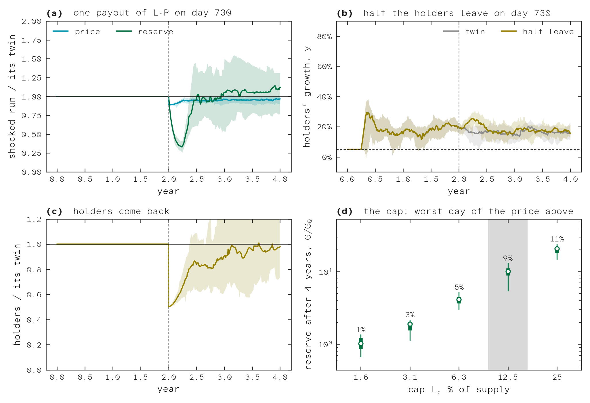</p>

*Рисунок 8. Каждый прогон с событием сравнивается с таким же прогоном без события, $`\varepsilon = 0{,}8`$. (a) На 730-й день один майнер добывает 12,5% выпуска. Цена падает примерно на 11% и к концу четвёртого года отстаёт от прогона без события на 3%. Резерв в медиане падает до 33% от прогона без события: после падения цены годовой рост для держателя снижается, и в модели держатели уходят чаще и приходят реже (раздел 8). К концу четвёртого года резерв на 12% больше, чем в прогоне без события. (b, c) На 730-й день уходит половина держателей. Рост цены для оставшихся держателей ускоряется, за полгода число держателей возвращается к 84% от прогона без события (медиана), а к концу четвёртого года — к 98%. (d) Панель показывает резерв через четыре года при разных лимитах добычи, 20 прогонов на лимит. Над столбцами указано наибольшее однодневное падение цены, медиана прогонов. При лимите 12,5% резерв вырастает в 10 раз, а наибольшее однодневное падение составляет 9%.*

На рисунке 8d лимит 1,6% даёт однодневное падение 1%, но резерв почти не растёт. Лимит 25% даёт рост резерва в 21 раз и падение 11%.

---

## 9. Случайность майнинга

Результат майнинга зависит от двух чисел: секрета майнера и случайного числа. В TON случайное число присылает оракул, в Solana его публикует сеть drand.

```math
\text{результат} = \text{секрет майнера} \oplus \text{случайное число}
```

Майнинг идёт по схеме commit-reveal:

1. **Майнер фиксирует секрет.** Начиная майнинг, майнер отправляет хеш SHA-256 секрета. После этого майнер не может заменить секрет: подобрать другой секрет с тем же хешем на практике невозможно.
2. **Появляется случайное число.** В TON в билет в начале майнинга записывается ключ оракула, и контракт принимает только число, подписанное этим ключом. В Solana в начале майнинга в билет записываются номер раунда drand и ключ сети drand (п. 9.1).
3. **Майнер раскрывает секрет.** Контракт сверяет секрет с хешем и вычисляет результат. Для каждой попытки контракт берёт 32 бита результата. Число единиц подряд, начиная с младшего бита, но не больше $`n-1`$, равно числу бросков до первого орла.

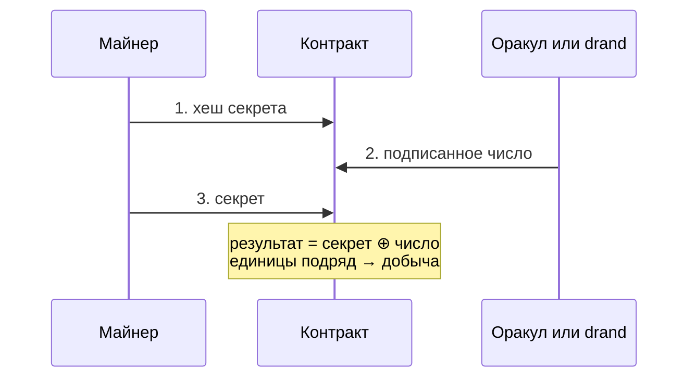

Ни майнер, ни источник числа не могут выбрать результат: секрет зафиксирован до появления числа, а источник числа видит только хеш секрета. Не раскрыть секрет майнеру тоже невыгодно: тогда билет закрывается с наименьшей добычей, а она не больше любого исхода.

После раскрытия секрет и случайное число записаны в блокчейне, и результат может пересчитать любой.

### 9.1. Раунды drand в Solana

drand — сеть независимых участников, которая каждые 3 секунды публикует случайное число очередного раунда. Число раунда — подпись BLS над его номером, собранная пороговым числом участников сети. У номера раунда одна верная подпись, поэтому сеть не выбирает число, а только публикует его.

1. **Начало майнинга.** Программа записывает в билет раунд, который выйдет не раньше чем через задержку развёртки (в тестовой сети 60 секунд), и ключ сети drand. Секрет майнера уже зафиксирован, а подписи этого раунда ещё нет.
2. **Раскрытие.** Майнер отправляет секрет вместе с подписью раунда. Программа проверяет подпись ключом, записанным в билет, и выводит из неё случайное число билета, привязанное к его номеру. Подпись чужого раунда или под другим ключом программа отвергает.
3. **Льготный период** отсчитывается от времени выхода раунда. После него билет можно закрыть с наименьшей добычей $`E \cdot a`$.

Число никто не доставляет: подпись раунда публикует сеть drand, и майнер прикладывает её к раскрытию, поэтому платы за доставку нет.

---

## 10. Контракты, параметры и SDK

### 10.1. Параметры протокола

Значения прочитаны из главных контрактов TON в тестовой сети.

| Параметр | Значение | Где действует |
|---|---|---|
| Комиссия Mint и Burn | 1,5625% | не входит в резерв |
| RTP | 87,5% | записывается в билет при покупке |
| Лимит добычи | 12,5% выпуска | проверяется в начале майнинга |
| Наименьший MIN | 1 PRDX | проверяется при покупке |
| Наибольший LVL | 24 (теоретически до 32, то есть 31 бросок) | проверяется при покупке |
| DRAWS | от 1 до 8 | |
| Льготный период | 5 минут (по умолчанию 24 часа) | записывается в билет при покупке |

Управление — это адрес администратора главного контракта. Управление может менять комиссии, лимит и источник случайного числа (в TON ключ оракула, в Solana сеть drand), а для новых билетов RTP, льготный период, наименьший MIN и наибольший LVL. Комиссии копятся в главном контракте отдельно от резерва, и выводит их управление. Управление может приостановить Mint, покупку билетов и начало майнинга. Burn, раскрытие секрета, отмену, передачу билета и понижение уровня приостановить нельзя. Команды управления не списывают PRDX с кошельков участников. Лимит проверяется в начале майнинга, поэтому после его изменения купленному билету иногда нужен более низкий уровень (RESHAPE, п. 4.2).

### 10.2. Контракты TON

| Стандарт | Применение |
|---|---|
| **TEP-74** | PRDX и кошельки держателей |
| **TEP-89** | поиск адреса кошелька PRDX |
| **TEP-62** | билеты как NFT коллекции протокола |

Главный контракт выпускает PRDX, хранит резерв, ведёт коллекцию билетов и принимает команды управления. В TON работают два главных контракта: с резервом в Gram и с резервом в USDT (джеттон). У каждого держателя свой кошелёк PRDX, у каждого билета свой контракт.

### 10.3. Программа Solana

Программа Solana работает по тем же правилам. Передать билет на Solana можно командой программы, тоже только до майнинга. Случайное число в Solana даёт раунд сети drand, а не оракул (п. 9.1).

| Что | Адрес в Solana devnet |
|---|---|
| программа | [`GEnxVEpR9ALBhqhQPgPqeb59VAZS2JxTFt4hUArRD2yJ`](https://explorer.solana.com/address/GEnxVEpR9ALBhqhQPgPqeb59VAZS2JxTFt4hUArRD2yJ?cluster=devnet) |
| пул с резервом в SOL | [`9jqvg7XBPRxcsjBkBPGDp7uY16bcpFTykmiec9JTzE3C`](https://explorer.solana.com/address/9jqvg7XBPRxcsjBkBPGDp7uY16bcpFTykmiec9JTzE3C?cluster=devnet) |
| токен PRDX этого пула | [`3RvcU914hXuNjxSLyMqSjLipYWDz1ote538wsdhqTnBN`](https://explorer.solana.com/address/3RvcU914hXuNjxSLyMqSjLipYWDz1ote538wsdhqTnBN?cluster=devnet) |

### 10.4. SDK для JavaScript

Для создания приложений на базе протокола PARADOX доступен SDK для JavaScript. Чтобы получить ранний доступ, заполните [форму на GitHub](https://github.com/prdx-admin/prdx-docs/issues/new?template=sdk-early-access.yml&from=docs). SDK распространяется по лицензии MIT.

---

## 11. Как попробовать протокол

1. Откройте приложение в браузере, [app.prdxcoin.com](https://app.prdxcoin.com), или в Telegram, [@prdxcoinbot](https://t.me/prdxcoinbot). В Telegram доступны развёртки TON, в браузере — развёртки TON и Solana.
2. Включите режим **TRIAL**. В этом режиме приложение работает с тестовым балансом без кошелька: можно сделать Mint, купить билет и добыть по нему PRDX, посмотреть историю операций. Льготный период в TRIAL длится 1 минуту, остальные параметры совпадают с тестовой сетью.
3. Чтобы работать с тестовой сетью, откройте раздел **CONNECT**, выберите сеть и валюту резерва (в TON: Gram или USDT, в Solana: SOL) и подключите кошелёк. Тестовые монеты выдаёт кран соответствующей сети.
4. Плашка **HOW IT WORKS** на главном экране открывает вводное обучение: парадокс протокола и стратегии Алисы и Боба. Кнопка **?** в шапке приложения открывает подробное обучение по текущему разделу.

Ссылки протокола:

| Ресурс | Ссылка | Что там |
|---|---|---|
| Сайт | [prdxcoin.com](https://prdxcoin.com/ru/) | протокол коротко, на пяти языках |
| Приложение в браузере | [app.prdxcoin.com](https://app.prdxcoin.com) | TRIAL и тестовые сети TON и Solana |
| Приложение в Telegram | [@prdxcoinbot](https://t.me/prdxcoinbot) | TRIAL и тестовые сети TON |
| Документация | [docs.prdxcoin.com](https://docs.prdxcoin.com/ru/) | этот документ на русском и [английском](https://docs.prdxcoin.com/en/) |
| Канал на русском | [t.me/prdxproject](https://t.me/prdxproject) | новости протокола |
| Канал на английском | [t.me/prdxcoinproject](https://t.me/prdxcoinproject) | новости протокола на английском |
| Чат | [t.me/prdxcoinchat](https://t.me/prdxcoinchat) | вопросы и обсуждение |
| X | [x.com/prdxdev](https://x.com/prdxdev) | посты разработчика |
| SDK | [п. 10.4](#104-sdk-для-javascript) | SDK для JavaScript, в раннем доступе |
| Симулятор | [prdx-sim](https://github.com/prdx-admin/prdx-sim) | модель протокола, из которой построены рисунки документа |
| Исходный текст документации | [prdx-docs](https://github.com/prdx-admin/prdx-docs) | этот документ в Markdown |

---

## 12. Риски

- **Тестовая сеть.** Протокол экспериментальный и работает в тестовых сетях.
- **Средний результат билета.** Средняя добыча равна 87,5% депозита. На каждом билете участник в среднем теряет 12,5% депозита. Чем большую долю PRDX участник тратит на билеты, тем ниже его средний результат (п. 7.2).
- **Падение цены после крупной добычи.** Добыча увеличивает выпуск PRDX при прежнем резерве, и цена снижается. Добыча одной попытки, равная лимиту, снижает цену примерно на 11%. В симуляции такое падение временно: в закрытом населении цена за год снижалась в 1–7,7% лет, в модели притока — в 2 годах из 240 (разделы 5, 6 и 8). Если крупная добыча выпадает по нескольким билетам или в нескольких попытках одного билета, цена снижается сильнее.
- **Зависимость от майнеров.** Цена растёт вместе с суммой депозитов (раздел 6). Если майнеров нет, цена не растёт.
- **Цена в монете резерва.** Цена PRDX выражена в монете резерва. Относительно других валют PRDX дорожает и дешевеет вместе с этой монетой.
- **Заморозка USDT.** USDT выпускает компания Tether, и она может заморозить USDT на любом адресе, в том числе на адресе резерва, например по требованию регулятора. Gram и SOL — монеты самих сетей, и заморозить их так нельзя.
- **Ошибки в контрактах.** Как у любого протокола в блокчейне, в контрактах могут быть ошибки.
- **Управление.** Управление меняет параметры протокола и может приостановить Mint, покупку билетов и начало майнинга. Burn приостановить нельзя. У купленного билета остаются прежние RTP и льготный период.

---

## 13. Частые вопросы

### 13.1. Какие комиссии у выпуска (Mint) и обмена (Burn) и зачем они?

По **1,5625%** с каждой операции. Комиссию Mint протокол берёт в монетах и не добавляет в резерв, а комиссию Burn берёт в PRDX и не сжигает. Цену PRDX обе операции не меняют. Комиссии защищают от арбитража. PRDX, уплаченные за билет, сгорают в начале майнинга, а добыча выпускается позже, и между этими моментами цена PRDX не ниже, чем после выпуска добычи. Без комиссий участник мог бы сделать Mint перед началом майнинга по чужому билету, а Burn до выпуска добычи и забрать часть роста цены без риска, а снижение цены от добычи пришлось бы на тех, кто хранит PRDX. С комиссиями такая сделка окупается, только если начало майнинга поднимет цену PRDX больше чем на 3,2%: меньший рост не покрывает двух комиссий. При большом выпуске PRDX обычный билет поднимает цену намного меньше (п. 2.5).

### 13.2. Чем PRDX отличается от стейблкоинов?

Курс стейблкоина привязан к доллару или другой валюте. PRDX обеспечен резервом и обменивается на монеты резерва в любой момент, но его цена равна резерву, делённому на число выпущенных PRDX, и в среднем растёт, пока идёт майнинг. Цена PRDX выражена в монете резерва, поэтому к другим валютам она меняется вместе с этой монетой.

### 13.3. PRDX — это пирамида?

**Нет.** В пирамиде старым участникам платят из взносов новых, поэтому обещанные выплаты всегда больше денег пирамиды: если все участники разом потребуют свои деньги с обещанным доходом, на всех не хватит. В PARADOX монеты из резерва выплачивает только Burn, по цене, равной резерву, делённому на число выпущенных PRDX. Поэтому все PRDX вместе стоят ровно столько, сколько монет в резерве. Burn цену не меняет, и если все держатели разом обменяют PRDX, последний получит за каждый PRDX столько же монет, сколько первый, за вычетом той же комиссии.

Взнос нового участника никому не выплачивается: Mint кладёт взнос за вычетом комиссии в резерв и выпускает на него PRDX по текущей цене, поэтому цена не меняется, а взнос обеспечивает PRDX самого участника. Цену PRDX поднимают только билеты: на них в среднем сгорает 12,5% их цены (раздел 6). Эту долю майнер отдаёт сам за шанс добыть во много раз больше, и она записана в билете до покупки.

Гарантированного дохода нет: цена PRDX растёт только в среднем и только пока идёт майнинг. Реферальных выплат нет. Списать PRDX с кошелька или приостановить Burn не может никто, в том числе разработчик и управление.

### 13.4. Есть ли предпродажа или доля команды?

Предпродажи нет. PRDX выпускает только главный контракт, и только в двух случаях: при Mint за монеты резерва по текущей цене и при майнинге по билету. Других способов получить новые PRDX нет ни у кого, в том числе у разработчика и управления.

### 13.5. Связан ли PARADOX с другими токенами с тикером PRDX?

Нет. Тикер PRDX используют и другие токены, не связанные с PARADOX. PRDX протокола PARADOX выпускают только контракты, адреса которых приведены в таблице в начале документации. Адреса проекта: сайт [prdxcoin.com](https://prdxcoin.com), приложение [app.prdxcoin.com](https://app.prdxcoin.com), бот в Telegram [@prdxcoinbot](https://t.me/prdxcoinbot).

### 13.6. Нужна ли для PRDX биржа?

Нет, пока Mint не приостановлен: PRDX выпускает сам участник, когда вносит монеты в резерв. Обменять PRDX обратно на монеты резерва можно в любой момент. Обе операции идут по цене, равной резерву, делённому на число выпущенных PRDX. При этом PRDX остаётся обычным токеном сети: его показывают кошельки, и его можно переводить.

### 13.7. Связаны ли сети TON и Solana и валюты резерва?

Нет. В TON PRDX выпускается за Gram или USDT, в Solana за SOL или USDT, и каждая из четырёх пар работает отдельно: у неё свой PRDX, свой резерв, своя цена и свои билеты. PRDX одной пары нельзя обменять на PRDX другой.

### 13.8. В каком стандарте выпущены PRDX и билеты?

В TON PRDX выпускается по стандарту Jetton (TEP-74), а билет как NFT (TEP-62). В описании NFT записаны уровень и состояние билета, и кошельки TON показывают билет среди других NFT.

В Solana PRDX выпускается по стандарту SPL Token. Билет там не NFT: он хранится в отдельном аккаунте программы протокола, и передать его можно командой этой программы.

В обеих сетях билет можно передать другому владельцу только до начала майнинга.

### 13.9. Что такое майнинг PRDX?

Билет даёт право на добычу (майнинг) PRDX. Когда начинается майнинг, уплаченные за билет PRDX сгорают, кроме части, равной наименьшей добыче. В конце майнинга майнер получает эту часть и новые PRDX сверх неё. У билета три параметра:

- **LVL** от 2 до 24 (теоретически до 32): число вариантов добычи.
- **MIN** от 1 PRDX: наименьшая добыча одной попытки.
- **DRAWS** от 1 до 8: число попыток.

В каждой попытке монету подбрасывают до орла, но не больше LVL − 1 раз, и с каждым броском без орла добыча удваивается. Средняя добыча равна **87,5%** цены билета при любых параметрах.

### 13.10. Кто определяет добычу и откуда слово «майнинг»?

Ни майнер, ни источник случайного числа в одиночку добычу не выбирают. Добыча вычисляется из секрета майнера и случайного числа извне. В TON это число присылает оракул, в Solana его публикует сеть drand. Секрет записывается в блокчейн в закрытом виде до появления этого числа. Майнер уже не может сменить секрет, а источник числа видит только его хеш. Оба числа хранятся в блокчейне, и добычу может пересчитать любой.

Слово «майнинг» взято по сходству с биткойном: майнинг стоит денег, а добыча случайна. В остальном майнинг устроен иначе: шансы заданы уровнем билета, добыча одного билета не зависит от других билетов, а транзакций майнинг не подтверждает.

### 13.11. Можно ли потерять PRDX на майнинге?

Да. В среднем билет возвращает 87,5% своей цены, то есть майнер теряет 12,5%. При одной попытке на высоком LVL добыча чаще всего меньше цены билета, а изредка во много раз больше: на LVL 24 добыча меньше цены билета в 15 случаях из 16, а наибольшая добыча больше цены в 587 тысяч раз.

### 13.12. Какой может быть добыча по одному билету?

Майнинг по билету начинается, только если наибольшая добыча одной попытки (MAX) не больше 12,5% всех выпущенных PRDX (лимит, раздел 5). Это до девятой части резерва в монетах по цене после выпуска добычи. Число попыток на лимит не влияет, поэтому билет с $`a`$ попытками добывает до $`a`$ лимитов, если MAX выпадет во всех попытках. Лимит растёт вместе с числом выпущенных PRDX: **чем больше PRDX выпущено, тем крупнее добыча, доступная по одному билету**.

Лимит защищает тех, кто хранит PRDX: добыча попытки, равная лимиту, снижает цену PRDX примерно на 11%. Билет выше лимита можно купить сейчас и начать майнинг, когда PRDX станет больше, или понизить его уровень (RESHAPE).

### 13.13. Можно ли передумать после покупки билета?

Да, пока майнинг не начался. Билет можно отменить и получить 87,5% его цены, остальные 12,5% сгорают. Ещё билет можно подарить или передать на другой адрес, а билет выше лимита можно перевести на более низкий уровень (RESHAPE).

### 13.14. Может ли цена PRDX снижаться?

Да. Добытые PRDX выпускает протокол, поэтому крупная добыча увеличивает число PRDX при прежнем резерве, и цена PRDX снижается, а крупная добыча по нескольким билетам сразу снижает её сильнее. Падение от добычи одной попытки ограничено лимитом: примерно 11%.

Если майнинг продолжается, после такого падения PRDX в среднем снова становится меньше, и цена PRDX в среднем растёт. В симуляциях prdx-sim цена PRDX за год снижалась в 7,7% лет при 100 участниках, в 1% лет при 100 000 и в 2 годах из 240 в модели, где участники приходят и уходят.

### 13.15. Может ли кто-то заморозить или забрать мои PRDX?

Со стороны протокола нет. Управление протоколом не может списать PRDX с кошелька и не может приостановить Burn, поэтому обменять PRDX на монеты резерва можно всегда. Управление может приостановить Mint, покупку билетов и начало майнинга и менять параметры для новых билетов, а у купленного билета доля средней добычи остаётся прежней.

У резерва в USDT есть внешний риск: USDT выпускает компания Tether, и она может заморозить USDT на любом адресе, в том числе на адресе резерва, например по требованию регулятора. Gram и SOL — монеты самих сетей, и заморозить их так нельзя.

### 13.16. Какие риски у протокола?

- Протокол экспериментальный и работает в тестовых сетях.
- В среднем майнер теряет на билете 12,5% его цены.
- После крупной добычи цена PRDX снижается.
- Цена PRDX растёт, только пока идёт майнинг.
- Цена PRDX выражена в монете резерва и меняется к другим валютам вместе с ней.
- USDT в резерве может заморозить его эмитент, компания Tether; у резерва в Gram и SOL такого риска нет.

---

## 14. Глоссарий

| Термин | Значение |
|---|---|
| **PRDX** | токен протокола, обеспеченный резервом; в каждой сети за каждую валюту выпускается свой PRDX |
| **Резерв, G** | монеты на счёте главного контракта: Gram или USDT в TON, SOL или USDT в Solana |
| **Выпуск, P** | количество PRDX в обращении |
| **Цена PRDX** | G/P, цена одного PRDX в монете резерва |
| **Mint** | выпуск PRDX за монеты, внесённые в резерв, по текущей цене G/P |
| **Burn** | сжигание PRDX и выплата монет из резерва по текущей цене G/P |
| **Билет** | право добыть PRDX, купленное за PRDX; на TON — NFT |
| **Майнинг** | выпуск PRDX по билету: контракт сжигает депозит, кроме наименьшей добычи, и выпускает остальную добычу |
| **Попытка** | серия бросков монеты до первого орла, не больше $`n-1`$ бросков; у билета от 1 до 8 попыток |
| **Добыча** | PRDX, которые майнер получает по билету |
| **Депозит, D** | цена билета в PRDX |
| **LVL, n** | число возможных исходов попытки |
| **MIN, E** | наименьшая добыча одной попытки |
| **MAX** | наибольшая добыча одной попытки, $`E \cdot 2^{\,n-1}`$ |
| **DRAWS, a** | число попыток по билету |
| **RTP** | средняя добыча в доле депозита, 87,5% |
| **Разброс** | отличие добычи отдельного билета от средней; задаётся уровнем и числом попыток |
| **RESHAPE** | понижение уровня билета до майнинга при том же депозите; стандартный способ начать майнинг по билету выше лимита |
| **Лимит добычи** | условие начала майнинга: MAX одной попытки не больше 12,5% выпуска |
| **Льготный период** | время на раскрытие секрета после появления случайного числа |
| **Оракул** | сервис, который присылает подписанные случайные числа билетам в TON |
| **drand** | сеть, которая публикует подписанные случайные числа раундами; источник случайного числа в Solana |
| **Управление** | адрес администратора главного контракта: меняет параметры, выводит комиссии, может приостановить Mint, покупку билетов и начало майнинга |
| **Оборот, T** | сумма долей PRDX участника, потраченных на билеты за год |

---

## Дисклеймер

В документе описано текущее состояние протокола PARADOX. Актуальные значения параметров хранятся в контрактах.

Документ — не финансовая рекомендация. PARADOX — экспериментальный протокол в тестовых сетях. Участник может потерять часть или все вложенные средства. Взаимодействуя с протоколом, вы подтверждаете, что:

- понимаете математическую модель протокола и её риски;
- используете тестовые токены без реальной ценности;
- сами отвечаете за свои решения;
- авторы документации не отвечают за убытки от использования протокола.

## Лицензия

Текст и рисунки документации распространяются по лицензии [Creative Commons «Атрибуция» 4.0 Международная (CC BY 4.0)](https://github.com/prdx-admin/prdx-docs/blob/main/LICENSE), © 2025–2026 prdx-admin. Их можно копировать, распространять и переделывать для любых целей, в том числе коммерческих. В копии указываются автор (prdx-admin), ссылка на документацию и на лицензию и отметка, изменён ли материал. Примеры кода в документации доступны также по лицензии [MIT](https://opensource.org/license/mit).

PARADOX и PRDX — названия протокола и его токена. Лицензия распространяется на текст и рисунки, а не на эти названия: копию нельзя выдавать за опубликованную или одобренную авторами PARADOX.
